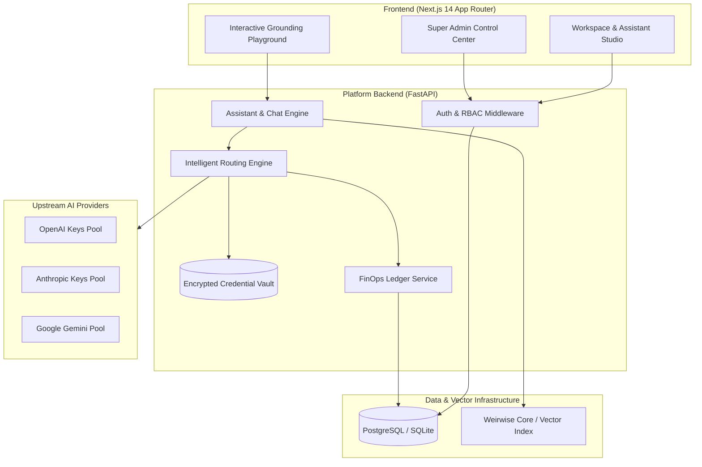

# <p align="center"><br>Weirwise Platform</p>

<p align="center">
  <strong>Enterprise Multi-Tenant AI Assistant, Credential Routing & Knowledge Grounding Platform</strong>
</p>

<p align="center">
  <a href="https://github.com/ansarialireza/weirwise-rag-platform/actions/workflows/backend-ci.yml"></a>
  <a href="https://github.com/ansarialireza/weirwise-rag-platform/actions/workflows/frontend-ci.yml"></a>
  <a href="LICENSE"></a>
  <a href="https://python.org"></a>
  <a href="https://nextjs.org"></a>
</p>

---

## Product Overview

**Weirwise** is being built to help businesses turn trusted knowledge into useful AI assistant experiences, while keeping people in control.

The current near-term experience is intentionally focused: a simple internal Weirwise assistant, configured and maintained by the Weirwise team, grounded in curated official product knowledge, and available through text and voice conversation. It helps users understand Weirwise and its currently available capabilities.

The longer-term direction is a platform where businesses can create, publish, manage, and improve assistants grounded in their own knowledge. That broader direction is not a claim that every capability is available today.

### Product principles
- **Grounded answers:** use approved knowledge and communicate uncertainty honestly.
- **Human control:** permissions and important decisions remain with people.
- **Progressive capability:** prioritize a reliable focused experience before adding complexity.
- **Clear UX:** keep interactions simple, responsive, and understandable.
- **Honest scope:** distinguish released functionality from roadmap ideas.

See [Product Vision](docs/PRODUCT_VISION.md) for the product definition, current scope, principles, and longer-term direction.

---

## Architecture Overview



---

## Key Capabilities

### 1. Intelligent AI Provider Routing & Failover
- **Multi-Key Credential Pools**: Register multiple API keys per provider family (OpenAI, Anthropic, Gemini).
- **Adaptive Routing Strategies**: Choose between `Round-Robin`, `Priority-Based`, `Weighted-Random`, or `Lowest-Cost`.
- **Automatic Circuit Breaking**: 60-second cooldown on HTTP 429 rate limits; 300-second circuit breaker upon 3 consecutive failures.
- **Cryptographic Vault**: Credentials encrypted at rest using AES-128-CBC + HMAC-SHA256 (Fernet) with SHA-256 deduplication and prefix masking (`sk-proj-...a1b2`).

### 2. FinOps Unit Economics & Ledger
- **Token Cost Ledger**: Immutable per-request token consumption accounting (prompt, completion, estimated cost in micro-dollars, and latency).
- **Executive Revenue Metrics**: Automatic aggregation of Monthly Recurring Revenue (MRR), Annual Recurring Revenue (ARR), paid invoices, and gross margins derived directly from database records.

### 3. Multi-Tenant Knowledge Grounding
- **Project & Assistant Scoping**: Multiple assistants per project with custom instructions, temperature, top-k retrieval, and score thresholds.
- **Interactive Playground**: Real-time conversational interface with grounded citation cards, similarity score inspection, and negative grounding fallback detection.

---

## Tech Stack

- **Backend**: Python 3.11, FastAPI, SQLAlchemy 2.0 (async), Alembic, Pydantic v2, Pytest, Ruff.
- **Frontend**: Next.js 14 (App Router), React 18, TypeScript, Tailwind CSS, Lucide Icons.
- **Storage & Security**: PostgreSQL / SQLite (compatible dual-driver), Fernet symmetric encryption, JWT authentication.

---

## Quick Start (Local Development)

### Prerequisites
- Python 3.11+
- Node.js 18+ (Node 20 recommended)
- Git

### 1. Clone & Setup Environment
```bash
git clone https://github.com/ansarialireza/weirwise-rag-platform.git
cd weirwise-rag-platform

# Copy environment template
cp .env.example backend/.env
```

### 2. Backend Setup
```bash
cd backend

# Create and activate virtual environment
python -m venv .venv
source .venv/bin/activate  # On Windows: .venv\Scripts\activate

# Install dependencies
pip install -r requirements.txt
pip install -e ".[dev]"

# Run database migrations
alembic upgrade head

# Start backend server (runs at http://localhost:8000)
uvicorn backend.app.main:app --reload
```

### 3. Frontend Setup
```bash
# In a separate terminal
cd frontend

# Install dependencies
npm install

# Start Next.js development server (runs at http://localhost:3000)
npm run dev
```

---

## Testing & Quality Assurance

### Run Backend Test Suite
```bash
# Execute unit and end-to-end integration tests
pytest backend/tests -v
```

### Run Linters & Type Checking
```bash
# Backend linting & format verification
ruff check backend/
ruff format --check backend/

# Frontend type check & linting
cd frontend
npm run type-check
npm run lint
```

---

## Project Structure

```
weirwise-rag-platform/
├── .github/                  # GitHub Actions CI workflows, issue & PR templates
│   ├── workflows/            # Backend and Frontend CI pipelines
│   └── ISSUE_TEMPLATE/       # Structured bug report and feature request forms
├── artifacts/                # QA audits, integration reports, screenshots, benchmarks
│   ├── screenshots/          # Application verification screenshots
│   └── logs/                 # Test and diagnostic run logs
├── backend/                  # FastAPI backend application
│   ├── alembic/              # Database schema migrations
│   ├── app/                  # Application core, models, schemas, and API routes
│   └── tests/                # Pytest unit and integration test suite
├── docs/                     # Technical specifications, architecture, and ADRs
│   ├── adr/                  # Architectural Decision Records
│   └── ARCHITECTURE.md       # Comprehensive system architecture documentation
├── frontend/                 # Next.js 14 Web Application
│   ├── public/               # Brand assets and SVG icons
│   └── src/                  # App Router pages, components, hooks, and lib
├── docker-compose.yml        # Docker service orchestration manifest
├── .env.example              # Canonical environment template
├── CONTRIBUTING.md           # Contribution guidelines & PR process
├── CODE_OF_CONDUCT.md        # Contributor Covenant Code of Conduct
├── SECURITY.md               # Security policy & vulnerability reporting instructions
├── CHANGELOG.md              # Semantic release notes and changelog
├── LICENSE                   # MIT License
└── README.md                 # Primary project overview and documentation
```

---

## Documentation

- [System Architecture](docs/ARCHITECTURE.md)
- [Domain Model & Invariants](docs/DOMAIN_MODEL.md)
- [API Contracts Reference](docs/API_CONTRACTS.md)
- [Development Guide](docs/DEVELOPMENT.md)
- [Security Policy](SECURITY.md)
- [Architectural Decision Records (ADRs)](docs/adr/)

---

## License & Security

This project is licensed under the terms of the [MIT License](LICENSE).  
For security concerns and vulnerability reporting, please refer to [SECURITY.md](SECURITY.md).
