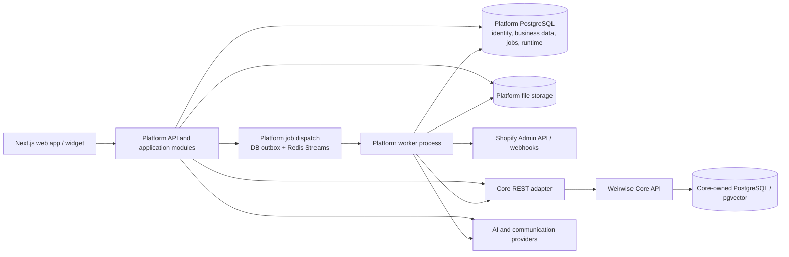

# Weirwise Target Architecture

> **Status:** Phase 2 design recommendation; not an implementation description or an accepted
> replacement for existing ADRs.
>
> **Scope:** Logical target for Weirwise Platform and its boundary with Weirwise Core. This document
> does not change application code, schemas, API contracts, or the brand repository's product
> roadmap. Product capabilities mentioned below remain future work unless the current capability
> documentation and source code say otherwise.
>
> **Evidence baseline:** The Phase 1 findings in [`WEIRWISE_ARCHITECTURE_AUDIT.md`](WEIRWISE_ARCHITECTURE_AUDIT.md),
> Platform's current architecture and domain docs, accepted ADRs 001, 003, and 004, and the Core
> REST contract. Reviewed November 10, 2026.

## 1. Architecture overview

### Recommendation: retain a modular monolith for Platform

Keep Platform as one deployable application with explicit in-process domain modules. Keep Core as
an independently deployable, reusable retrieval service consumed only over its public REST API.
Do not split Platform responsibilities into microservices now.

This is the smallest architecture that fits the current evidence and product direction:

- Platform already owns authentication, user-owned resources, billing, provider orchestration,
  assistant runtime, and its own database. These domains need transactional coordination and do not
  have demonstrated independent scale or deployment requirements.
- The Core boundary is already established in accepted
  [ADR 001](docs/adr/001-architecture-boundaries-and-core-decoupling.md): Platform uses
  `backend/app/adapters/core_client.py` and Core's public REST contract, not shared models or
  database access.
- The Phase 1 audit found no provider-specific Shopify ingestion implementation. Separating a
  not-yet-built connector into a service would add deployment and consistency costs before a
  concrete need exists.
- Platform already has distinct mechanisms for request-process ingestion, Redis Streams behavioral
  processing, and Core's own database-backed ingestion worker. The remedy is to define one
  dependable Platform job path, not add another service or queue framework.

Current implementation anchors:

- The API lifecycle and router composition are in [`backend/app/main.py`](backend/app/main.py).
- User identity and the generic integration schema are in
  [`backend/app/models/auth.py`](backend/app/models/auth.py) and
  [`BusinessIntegration`](backend/app/models/assistant.py#L244).
- Integration credential storage and the explicit unsupported-sync result are in
  [`backend/app/services/integrations.py`](backend/app/services/integrations.py); the authenticated
  routes are in [`backend/app/api/v1/integrations.py`](backend/app/api/v1/integrations.py).
- Request-process document ingestion is in
  [`backend/app/tasks/ingestion.py`](backend/app/tasks/ingestion.py); behavioral Redis Streams
  consumption is in [`backend/app/services/behavioral_worker.py`](backend/app/services/behavioral_worker.py).
- Platform-to-Core HTTP calls are isolated in
  [`backend/app/adapters/core_client.py`](backend/app/adapters/core_client.py); current local
  filesystem storage is in [`backend/app/services/storage.py`](backend/app/services/storage.py).
- The direct-user ownership and deprecated workspace compatibility tests are in
  [`backend/tests/test_direct_user_architecture.py`](backend/tests/test_direct_user_architecture.py).

The diagram is a target, not a claim that the outbox, Shopify connector, or durable Platform worker
already exists. Core keeps its own database-backed ingestion jobs and worker. Platform's job
transport is a separate concern and must not reach into Core's job tables.

### Deployment shape

- **Platform API:** FastAPI application, public and authenticated HTTP routes, typed application
  services, Platform SQLAlchemy persistence.
- **Platform worker:** A separately runnable process using the same Platform modules and database
  contracts for long-running integration sync and other durable work. It is not a separate domain
  microservice.
- **Platform web app:** Next.js frontend using Platform's versioned HTTP API; it must not connect
  directly to either database or upstream Shopify.
- **Core:** Independent service with its own API keys, tenant records, database, worker, SDK, and
  versioned REST contract. Platform's Core IDs are opaque references.
- **External providers:** Shopify, LLM/embedding providers, voice, mail, payment, and customer
  webhook destinations are called only from server-side adapters.

PostgreSQL remains the source of truth for Platform-owned records and job state. Redis is suitable
for dispatch, rate limiting, and event transport where configured, but it is not the only durable
record of a requested operation. File storage remains behind Platform's storage service; object
storage is a future adapter choice, not an assumption that S3 support is present.

## 2. Module responsibility map

These are logical boundaries, not instructions to create one package or service per row. The listed
interfaces and events are **proposed internal contracts** unless a current public API is explicitly
identified. Modules communicate through typed application-service interfaces and versioned event
envelopes; they do not import one another's route handlers or reach across repository databases.

| Module | Responsibility and public interfaces | Owned data | Dependencies and events | Required tests | Explicitly excluded |
|---|---|---|---|---|---|
| **Identity and account ownership** | Register, authenticate, recover, and resolve the current customer principal. Internal `CurrentPrincipal`/`UserContext` supplied to application services. Existing auth routes remain the public contract until separately reviewed. | `User`, sessions, verification and reset tokens. The user ID is the account ownership key. | Depends on Platform persistence and security primitives. Emits `AccountUserCreated`, `AccountUserDisabled`, and `SessionRevoked` only where consumers need them. | Auth lifecycle, token expiry/revocation, inactive users, API-key scope, and cross-user ownership tests. | Workspaces, projects, membership, customer-selected account IDs, or a duplicate Account entity. |
| **Shopify integration** | Own OAuth/callback handling, store identity, least-privilege scopes, credential lifecycle, Shopify Admin API calls, webhook validation, and provider-specific mapping. Proposed `ShopifyConnectionService` and provider adapter interface. | User-owned store connection, encrypted token material, granted scopes, remote shop ID/domain, status, and provider cursors. | Depends on identity, secrets, job dispatch, and Business Data contracts. Emits `StoreConnected`, `StoreReauthorizationRequired`, `StoreDisconnected`, and normalized change requests. | OAuth state/CSRF, redirect allowlist, scope checks, HMAC verification, replay/deduplication, pagination, rate-limit and API error contract fixtures. | Business policy, canonical business-data persistence, direct Core DB access, and customer-facing assistant logic. |
| **Business Data** | Store normalized, account-owned facts from stores and other approved sources. Proposed typed read/write interfaces for products, variants, collections, inventory/prices, policies/pages, source provenance, and freshness. | Canonical records, source connection and remote IDs, versions, timestamps, and deletion/tombstone state. | Depends on persistence and connector-neutral contracts; consumed by sync, Knowledge, Runtime, Analytics. Emits `BusinessRecordChanged` and `BusinessRecordDeleted`. | Normalization fixtures, idempotent upsert, multi-store collision, provenance, update and deletion tests. | Shopify HTTP/OAuth details, embeddings, prompt construction, or account-level authorization decisions. |
| **Data ingestion and synchronization** | Coordinate initial/full sync, incremental sync, webhook-triggered refresh, reconciliation, progress, retries, and removal. Proposed `request_sync(connection_id, mode)` and job-status interface. | Sync cursors/checkpoints, operation status, attempts, timestamps, error categories, and durable job/outbox records. | Depends on integration adapters, Business Data, job dispatch, Knowledge, and audit events. Emits `SyncRequested`, `SyncCompleted`, `SyncFailed`, and `KnowledgeRefreshRequested`. | Idempotency, interruption/restart, out-of-order and duplicate webhooks, retry exhaustion, reauthorization, deletion propagation, and end-to-end fake-provider sync. | Provider-specific API calls in routes, silent success fallbacks, and customer-facing product decisions. |
| **Knowledge Engine** | Prepare searchable knowledge and return grounded retrieval results. Platform owns source-to-Core mapping and Core HTTP adapter; Core owns document indexing, chunks, embeddings, and retrieval implementation. | Platform knowledge-source metadata and opaque Core IDs; Core-owned knowledge records remain in Core. | Depends on Business Data/ingestion for content snapshots and on the Core REST adapter. Emits/consumes `KnowledgeIndexingStarted`, `KnowledgeReady`, `KnowledgeFailed`, and deletion commands. | Core contract tests, source ownership-before-call, indexing state transitions, retry and deletion propagation, retrieval relevance/fallback tests. | Core database access, Platform identity in Core, Shopify transport, or AI provider routing. |
| **AI Orchestration** | Select configured model/provider, construct bounded grounded requests, stream or return output, enforce token/latency policies, and meter provider use. | Provider routing configuration, encrypted provider credentials, request usage/cost and health records. | Depends on secret management, Knowledge retrieval results, Agent Runtime policy, and usage accounting. Emits `ModelRequestCompleted` or `ModelRequestFailed` with non-sensitive metadata. | Provider adapter contract, prompt-boundary, no-passage fallback, timeout/retry, streaming, cost calculation, and secret-redaction tests. | Direct account resource authorization, Shopify calls, unapproved autonomous actions, or provider secrets in browser responses. |
| **Agent Runtime and tools** | Resolve a published agent/deployment, orchestrate retrieval and response, and expose explicitly authorized tools. Current Platform assistant/runtime APIs remain authoritative; future tool contracts are added only with approval. | Agent configuration/snapshot, deployment settings, conversation and message records, and tool policy references. | Depends on ownership, Knowledge, AI Orchestration, Communication, and (only when enabled) authorized tool adapters. Emits `ConversationStarted`, `MessageRecorded`, `HandoffRequested`, and audited `ToolInvocationRequested`. | Runtime API and widget tests, published snapshot isolation, anonymous session binding, tool permission/approval, prompt injection, and cross-account conversation tests. | A general autonomous agent, bypassing Platform authorization, or writing to Shopify without an approved capability and policy. |
| **Memory and customer intelligence** | Future, opt-in and policy-bounded use of conversation context and customer signals to improve relevance. Begin with explicit session context; persistent customer memory is a later product decision. | If approved later: purpose-limited customer identifiers, consent/retention state, derived memory with provenance and expiry. | Depends on Runtime, Communication, consent/privacy policy, and account ownership. Proposed events: `MemoryCandidateRecorded`, `MemoryExpired`, `MemoryDeleted`. | Consent and minimization, tenant isolation, retention/deletion, provenance, access and opt-out tests. | Silent profiling, indefinite retention, treating anonymous visitors as known customers, or autonomous self-modification. |
| **Event processing and background jobs** | Persist and execute durable asynchronous operations with idempotent handlers, leases, bounded retry, cancellation where safe, and operator-visible failure. Proposed typed job envelope plus DB outbox and the existing Redis Streams infrastructure as dispatch. | Platform job/outbox records, attempts, leases, completion and failure metadata. | Depends on Platform DB and Redis dispatch. Consumes domain events and dispatches integration, ingestion, analytics, and delivery work. Core's worker remains independent. | Duplicate delivery, crash/reclaim, lease/fencing, outbox recovery, Redis outage, dead-letter/replay controls, and ownership-context tests. | A second overlapping queue framework, business rules inside the transport, or treating Redis messages as the only source of truth. |
| **Analytics and intelligence** | Produce account-scoped operational metrics and, later, store/conversation insights. Keep current product telemetry (Platform user-interface behavior) distinct from customer business analytics. | Aggregates/materialized summaries, calculation window, provenance, and source event references. | Depends on approved events from Runtime, Business Data, Billing, and Event Processing. Emits derived `InsightAvailable` only when a defined capability is implemented. | Aggregate correctness, time-window boundaries, tenant isolation, redaction/minimization, late/duplicate events, and reproducibility. | Raw cross-account access, presenting telemetry as business intelligence, or ungrounded causal claims. |
| **Communication and human handoff** | Manage customer-visible channels, conversation delivery, escalation, and delivery status. Existing widget/runtime remains the initial channel; additional channels are future adapters. | Conversation delivery and handoff request/status records, contact details only when provided and needed. | Depends on Runtime, deployment policy, jobs, and authorized channel adapters. Emits `HandoffRequested`, `HandoffAssigned`, `HandoffResolved`, and delivery status events. | Widget-origin and deployment authorization, session continuity, duplicate delivery, escalation, privacy, and provider timeout tests. | Business intelligence calculation, integration synchronization, or channel-specific copies of agent intelligence/configuration. |
| **Security and governance** | Cross-cutting policy enforcement: authentication/authorization primitives, scopes, secret handling, audit events, retention, privacy, safe tool policy, and staff-only administration. | Platform API credential hashes/scopes, audit records, secrets metadata/rotation version, governance settings. | Required by every module. Emits security/audit events; no module may skip its checks by calling a lower layer directly. | Authorization matrix, IDOR/cross-account regression, staff privilege, secret handling, audit completeness, CSRF/CORS, webhook, and abuse/rate-limit tests. | A second ownership model or an implicit admin bypass of resource authorization/audit. |
| **Billing and usage** | Enforce user/account plan entitlements and record billable operations; separate customer usage from internal provider spend and staff financial controls. | User-owned subscriptions/orders/invoices/usage and platform provider-cost ledger. | Depends on Identity, Runtime, ingestion and AI Orchestration events. Emits `UsageRecorded`, `EntitlementChanged`, and payment-status events. | Ownership of invoices/orders, entitlement boundaries, idempotent webhooks/charges, usage accuracy, reconciliation, and admin/customer access tests. | Provider routing policy, raw secrets, or assuming a configured plan/payment gateway is active in every environment. |

### Repository ownership

- **Brand repository:** canonical identity, principles, terminology, and product roadmap. It does not
  define runtime schemas or claim implementation status.
- **Platform repository:** all customer account ownership, integration connections, normalized
  business data, Platform APIs, agent configuration/runtime, billing, and Platform analytics.
- **Core repository:** reusable ingestion, document storage/indexing, embeddings, retrieval, SDK,
  and Core API tenant/key administration. It must not depend on Platform accounts or Shopify.
- Platform-to-Core communication is through the public REST contract and `CoreApiClient`; no shared
  ORM models, internal Python imports, or cross-database queries.

## 3. Dependency rules

1. **Routes are adapters.** HTTP routes authenticate, validate request schemas, call application
   services, and shape responses. They do not contain connector protocol, orchestration, or
   cross-account data selection logic.
2. **Ownership is checked before work.** Any resource ID is loaded under the authenticated
   principal, including all parent/child links, before reading, mutating, enqueueing, or passing
   opaque Core IDs downstream.
3. **Application services depend inward on interfaces.** Shopify and AI provider implementations
   sit behind narrow ports. Domain logic accepts typed values, not FastAPI `Request`, SQLAlchemy
   ORM objects from another module, or upstream-provider response dictionaries.
4. **Business Data is provider-neutral.** Connector adapters map upstream payloads to normalized
   Platform contracts. Runtime and Knowledge do not parse Shopify API responses.
5. **Core is an external service boundary.** Platform's adapter handles REST transport, timeouts,
   authentication, and error translation. Core IDs remain opaque; Core schema/database details
   remain private to Core.
6. **Events are contracts, not a shared database.** Use versioned, minimal payloads with stable
   identifiers. Consumers load current authorized state from their owning module rather than
   trusting event-supplied secrets or mutable customer data.
7. **No cycles.** Dependencies flow from API/worker entry points to application services, domain
   contracts, persistence and outbound adapters. Modules publish events instead of importing
   downstream modules to invoke their routes or repositories.
8. **Shared contracts are narrow.** Share basic identifiers, timestamps, enums, and DTOs only when
   they are stable and genuinely cross-module. Do not create a universal model package that couples
   every domain or share Platform models with Core.
9. **One Platform job system.** The current target uses PostgreSQL as the authoritative job/outbox
   state and existing Redis Streams as dispatch. Do not wire Celery as a second system. Validate
   Redis durability/availability and worker operations before relying on dispatch in production.
10. **Product UI is not a security boundary.** Frontend hiding, workspace-compatible routes, widget
    origin checks, and client-supplied identifiers do not substitute for server-side authorization.

## 4. Single-account / single-space ownership model

### 4.1 Identity and account principal

Retain the accepted decision in [ADR 004](docs/adr/004-single-account-model.md): the authenticated
Platform `User.id` is the customer-account ownership key. Do not add a separate `Account` model just
to rename or wrap `User`; do not add workspace, project, or membership entities. This matches the
current persisted model and the product's single unified environment.

The word **account** is a product/authorization concept mapped to the `User` principal in this
implementation, not a second row or a client-selected identifier. A future requirement for multiple
human users sharing a customer account would invalidate this one-user mapping and require a separate
review and migration design; it is not implied by this target.

### 4.2 Ownership and authorization

- Every customer-owned top-level resource has a Platform owner key (`user_id` under the current
  model). Child resources may inherit ownership through a parent, but queries and mutations must
  prove the full parent path belongs to the authenticated user.
- Derive owner identity from the resolved JWT/cookie/API-key principal. Never accept `user_id`,
  Core tenant ID, or account ID from a customer as authority.
- Resolve assistant-to-source links only when both records belong to the same owner.
- Conversation and message access is authorized through the owned assistant or an authorized public
  deployment/session. Public widget keys authorize only their active deployment and configured
  origin; they do not grant dashboard or account access.
- Platform-issued API keys remain user-owned and scope-limited. Public chat/share/widget access
  remains a separate, least-privilege contract.
- Core currently sees the Platform service tenant through the configured service API key rather
  than a distinct Core tenant per Platform user. Therefore Platform must verify source, assistant,
  and Core-ID ownership before **every** Core operation. Per-customer Core credentials are not
  assumed; revisit only if a concrete threat model and supported Core provisioning lifecycle justify
  the added identity and secret-management complexity.

### 4.3 Multiple stores and integrations

One account may own multiple integration connections, including multiple Shopify stores and other
providers. Each connection is a child resource of the same account, never a workspace.

The current unique key `(user_id, provider)` permits only one connection per provider. The target
connection identity must distinguish at least:

- internal immutable connection ID;
- owning `user_id`;
- provider and provider-side installation/shop identifier;
- display name/domain as non-authoritative metadata;
- encrypted credentials, granted scopes, status, and lifecycle timestamps.

Business records are keyed by owner + connection + provider's stable record ID (and, where required,
variant ID). Data from two stores must not collide merely because their SKUs or handles match.
Disconnecting one store must not delete another store's records or the account itself.

### 4.4 Background work and staff access

- Persist owner ID, connection/resource ID, job type, idempotency key, and correlation ID with each
  account-owned job. Resolve and verify ownership again in the worker from persisted records; do not
  treat an enqueue payload as authorization.
- A job is scoped to the owner and resource that created it. Cancellation, retry, status reads, and
  replay are owner-checked; administrative replay is separately audited.
- Staff operations use explicit staff privileges and least privilege. Staff status may permit
  platform administration but does not silently bypass customer ownership, privacy, or audit
  requirements. Record actor, target owner/resource, action, reason where applicable, and outcome.
- Keep operational telemetry and employee behavioral insights distinct from customer business
  records and analytics.

## 5. Data and integration flow

The following is a target lifecycle. It is not implemented Shopify behavior.

1. **Connect and authorize.** An authenticated user starts an OAuth attempt. Platform creates
   single-use state bound to the user/session, checks the callback host/redirect, validates state
   and Shopify's callback signature, requests only required scopes, and stores the resulting
   credential encrypted. Connection identity is based on the verified remote shop identity, not a
   user-entered display name. Never log access tokens.
2. **Create initial sync job.** In the same Platform database transaction, record the connection
   lifecycle and a durable `SyncRequested` outbox row with owner and idempotency context. A relay
   dispatches a typed job to Redis Streams. The API reports an accepted/queued state, not a
   successful import.
3. **Fetch provider data.** The connector paginates products, variants, collections, inventory and
   prices, plus approved store policies/pages. It respects provider rate-limit responses and
   records progress/cursors. Shopify payloads remain at the adapter boundary.
4. **Normalize and persist.** Map each record into a versioned, provider-neutral Business Data
   contract that retains source connection, remote ID, observed/updated timestamps, provenance,
   and deletion state. Upserts are idempotent. Persist a coherent snapshot or record versions so
   consumers do not mistake a partially completed full sync for the current complete catalog.
5. **Prepare knowledge.** Build curated, bounded documents or metadata payloads from normalized
   business facts and call Core only through its public API. Track Platform source-to-Core ID
   mappings and wait for Core's terminal indexing state before marking knowledge ready. Core
   stores/indexes knowledge; Platform owns business facts and customer ownership.
6. **Analyze and configure defaults.** Only after sufficiently complete, validated data exists,
   derive initial business/brand observations and assistant defaults. Store the evidence and status;
   never claim an analysis succeeded on an empty, failed, or stale sync. Human review remains
   available for impactful configuration.
7. **Serve customer interactions.** The Runtime verifies the published agent/deployment, retrieves
   relevant knowledge and/or reads narrowly scoped current Business Data for structured product
   facts, generates a grounded answer through AI Orchestration, and applies explicit freshness and
   fallback policy. Inventory and price statements must not be presented as live unless the data
   contract supports that freshness guarantee.
8. **Keep data current.** Validate webhook HMAC over the raw request body before accepting events.
   Deduplicate by provider event ID; treat a webhook as a notification to fetch/reconcile canonical
   state, not as guaranteed ordered truth. Apply updates idempotently and enqueue affected Knowledge
   refreshes. Run a periodic reconciliation so missed webhooks do not cause permanent drift.
9. **Update and delete.** Upstream updates create a new normalized version and refresh affected
   knowledge. Upstream deletions/disconnections create tombstones and remove or de-index the
   corresponding Core content; do not leave deleted product text searchable indefinitely.
   Account deletion and retention policies cover Platform copies, Core references/documents,
   conversations, and backups according to an explicit deletion contract.

### Failure and retry behavior

- Use bounded exponential backoff with jitter for transient network failures, 5xx responses, and
  rate limits; honor `Retry-After` where provided. Enforce per-provider concurrency/rate limits.
- Treat invalid/revoked authorization and insufficient scopes as a terminal connection state that
  pauses sync and asks for reauthorization; do not retry indefinitely.
- Make handlers idempotent and safe under duplicate, delayed, or out-of-order webhook/job delivery.
- Persist attempt count, next retry time, sanitized error category/message, timestamps, and terminal
  status. After the retry budget, move the operation to an inspectable dead-letter/failed state with
  an audited replay path; do not report success or silently discard it.
- If Core is unavailable, retain the Platform sync state and retry only the Knowledge step; do not
  refetch all Shopify data unnecessarily. If Core indexing fails, retain the last known good
  searchable snapshot where safe and clearly mark the latest data as not ready/stale.
- Surface actionable status in the UI and structured logs using correlation IDs. Never expose
  provider response bodies containing secrets or customer data.
- Define consistency as eventual for imported catalog/policies, show last-successful-sync/freshness,
  and use a conservative fallback when freshness is outside the product's declared threshold.

## 6. API and internal contracts

### Public HTTP contracts

- Existing Platform routes, schemas, status codes, streaming behavior, auth mechanisms, and
  compatibility paths are unchanged by this design.
- New provider callbacks and webhooks, when implemented, must have explicit signature/state
  verification, replay/deduplication behavior, bounded payloads, and stable error handling.
- Customer-facing APIs return owned resources and operational states, not SQLAlchemy records,
  decrypted credentials, internal prompts, provider secrets, or Core database details.
- Keep the legacy workspace/project API compatibility behavior until actual consumers and a
  reviewed deprecation plan permit change. New client flows use direct user-owned resources.

### Internal contracts

- Define typed request/result DTOs at module boundaries, such as `ConnectionIdentity`,
  `NormalizedProduct`, `NormalizedPolicy`, `SyncCheckpoint`, `JobContext`, and `GroundedAnswer`.
  These are design examples, not current shared schema definitions.
- Define provider ports such as `authorize`, `fetch_page`, `verify_webhook`, `normalize`, and
  `revoke`; implementation-specific HTTP clients stay inside adapters.
- Use a versioned event envelope with `event_id`, `event_type`, `schema_version`, `occurred_at`,
  `owner_id`, `aggregate_id`, `correlation_id`, and minimal data. The owner is contextual data for
  routing/observability, never a substitute for a fresh authorization/ownership lookup.
- Publish only committed business changes. A transactional outbox avoids the DB/queue dual-write
  gap; the relay may deliver more than once, so consumers must deduplicate/idempotently apply.
- Translate Core REST failures into Platform-owned typed errors at the adapter. Keep Core API
  authentication and its public contract separate from Platform user authentication.
- Do not share ORM models between modules or repositories. Shared contracts should be versioned
  independently of database persistence and public HTTP schemas.

### Core REST compatibility

The Platform adapter remains the only Platform-to-Core boundary. The Core contract in
[`../weirwise-rag-core/CONTRACT.md`](../weirwise-rag-core/CONTRACT.md) governs endpoint paths,
authentication, data shapes, and Core release compatibility. Any new need (for example deleting or
replacing a synchronized document) must first be verified against that contract; do not assume an
endpoint exists or modify Core internals from Platform.

## 7. Security boundaries

### Authentication and account isolation

- Resolve the current principal server-side from an active Platform session/JWT or valid
  user-scoped API key. Keep password/reset/session tokens hashed as applicable and revoke sessions
  on security-sensitive changes.
- Add owner filters at the query boundary and verify parent ownership for nested resources. Avoid
  lookup-by-ID followed by an unscoped update/delete.
- Treat Platform's shared Core service key as a privileged integration credential. It must never
  reach a browser or customer response. Platform must authorize each Core ID against its own
  user-owned mapping first.
- Test that user A cannot read, mutate, delete, link, search, or enqueue work for user B's resources,
  including through nested IDs, Core references, API keys, background jobs, and public conversation
  continuation.

### Shopify and webhook security

- Use one-time OAuth state bound to the initiating authenticated session, strict redirect/host
  validation, least-privilege scopes, callback signature validation, secure token storage, and
  explicit reauthorization/revocation behavior.
- Validate inbound Shopify webhook HMAC from raw bytes using constant-time comparison before
  parsing or enqueuing; bound request size and processing time. Deduplicate and reject stale/replayed
  deliveries according to provider event semantics.
- Keep outbound customer webhooks separate from Shopify inbound webhooks. Revalidate outbound
  destinations and redirects, prevent private/loopback/metadata-network access, sign payloads,
  rotate secrets, and cap response data and retries.

### Secrets, audits, admin, privacy

- Keep all integration/provider credentials server-side and encrypted at rest using the existing
  vault boundary; plan key rotation and secret versioning. Production key material must come from
  the approved environment secret manager, not source or generated defaults.
- Redact credentials, tokens, customer message content, and sensitive provider payloads from logs,
  telemetry, exceptions, and audit event details.
- Audit authentication/security events, integration connect/reauthorize/disconnect, sync lifecycle,
  permission-sensitive configuration changes, staff access, and destructive operations. Audit
  records need actor, target owner/resource, action, timestamp, outcome, and correlation ID; audit
  access is restricted and retention is defined.
- Use staff allowlisting/privileges as an administrative authorization layer, not a tenant bypass.
  Require explicit authorization and audit for cross-account support access; avoid broad staff data
  visibility by default.
- Define retention, export/deletion, consent, and minimization before introducing persistent
  customer memory or conversation-based intelligence.
- Apply rate limits and payload validation at login, public runtime, API-key routes, and provider
  callbacks. Cookie-authenticated state-changing requests require CSRF protections consistent with
  the deployed cookie and origin policy.

## 8. Testing strategy

All levels must include an explicit account-isolation category. Tests use synthetic data and fake
provider/Core clients by default; live credentials and shared databases do not belong in routine CI.

| Level | Scope and responsibility |
|---|---|
| **Unit** | Pure Shopify normalization, OAuth state validation, signature verification, idempotency decisions, mapping, freshness policy, retry classification, entitlement calculation, prompt assembly, and secret redaction. |
| **Integration** | Platform repository transactions, unique connection identity, outbox-to-Redis relay/recovery, job leasing/retry, Business Data upserts/tombstones, Core adapter error mapping, storage lifecycle, and worker restart behavior. Run PostgreSQL-specific behavior against disposable PostgreSQL in addition to SQLite fast tests where dialect semantics matter. |
| **Provider contract** | Recorded/fake Shopify payload and pagination/rate-limit/error fixtures; OAuth and webhook signature fixtures; Core REST contract tests against the documented/public API; provider adapters must not require live credentials in CI. |
| **API/authorization** | Route/schema/status/auth tests for integration lifecycle, sync status, callbacks, public runtime, and errors; cross-account IDOR tests for every resource and nested relationship. Assert that unauthorized requests cannot trigger jobs or outbound Core/provider calls. |
| **End-to-end** | Disposable Platform + Core + PostgreSQL + Redis flow: connect fake Shopify, initial sync, normalized data and knowledge readiness, grounded response, incremental update, deletion propagation, disconnect, and recovery from provider/Core/worker failures. |
| **Security** | OAuth CSRF/state/replay, webhook HMAC/replay/body limits, secret exposure, SSRF, tenant isolation, admin access/audit, rate limits, prompt injection/data exfiltration boundaries, and retention/deletion. Add regression tests for every confirmed issue. |
| **Operational/reliability** | Duplicate/out-of-order events, Redis outage/replay, worker crash and lease expiry, retry exhaustion/dead-letter replay, Core outage, stale snapshots, and observable alert/status behavior. Avoid claims of exactly-once processing; design for at-least-once delivery with idempotency. |

CI should keep existing Ruff, mypy, pytest, ESLint, TypeScript, and frontend build gates. Add test stages only with the infrastructure the test needs, use isolated databases, and publish coverage as evidence rather than treating a percentage as proof of tenant safety.

## 9. Migration and compatibility considerations

No schema or contract change is made in Phase 2. Any later implementation must:

1. Inspect the current Alembic chain, deployed database revision, and actual deployment migration
   process. Current startup also calls `Base.metadata.create_all`; reconcile that dual lifecycle
   before depending on migrations for production changes. See
   [`docs/DATA_AND_MIGRATIONS.md`](docs/DATA_AND_MIGRATIONS.md).
2. Design a non-destructive change from one row per `(user_id, provider)` to distinct
   provider-owned connections before supporting multiple Shopify stores. Define deterministic
   backfill for the existing row, unique constraints, remote-shop identity, duplicate resolution,
   and rollback/forward-only behavior. Do not represent a store as a workspace.
3. Add normalized Business Data tables/records only for validated V1 requirements. Keep ownership
   and provider provenance on each record and index owner/connection/external IDs. Avoid premature
   generic schemas for every roadmap capability.
4. Reconcile ownership and uniqueness of child records such as documents and assistant-source links.
   Preserve existing opaque Core references and prove every mapping before issuing Core operations.
5. Introduce durable job/outbox persistence additively. Keep the existing request contract stable
   while replacing in-process dispatch behind the service boundary; expose a truthful queued/running/
   failed/ready state only after the relevant operation actually reaches that state.
6. Define deletion and backfill behavior for Platform and Core copies before shipping integration
   disconnect, account deletion, or product removal.
7. Add migration tests for fresh installation and upgrade from the previous revision, including
   PostgreSQL behavior and idempotent backfill. Run only on an explicitly disposable database until
   deployment approval.
8. Keep Core migrations, database, and release lifecycle independent. Platform may request Core API
   capabilities only through a separately reviewed Core contract change.
9. Preserve existing workspace/project compatibility endpoints and response contracts until
   consumers and deprecation requirements are verified.

## 10. Decision record and alternatives

These are recommendations for review, not new accepted ADRs.

| Proposed decision | Rationale | Alternative considered and why deferred |
|---|---|---|
| **P2-D1: Keep Platform a modular monolith; Core remains separate behind REST.** | Current domains are transactionally related, boundaries exist, and independent scale/release pressure is unproven. | Platform microservices: would introduce distributed transactions, operational burden, and more failure modes without a demonstrated requirement. |
| **P2-D2: Keep `User.id` as the account principal and owner key.** | Directly follows accepted ADR 004 and current schema; avoids duplicate account/membership concepts. | New Account or Workspace tables: no concrete need for a multi-user account boundary was established. |
| **P2-D3: Model each store as an owned integration connection, not a workspace.** | Supports multiple stores within one unified account while separating provider installation identity from account identity. | Keep one `(user_id, provider)` connection: incompatible with the stated multi-store product direction. Immediate schema redesign is deferred to implementation approval and migration plan. |
| **P2-D4: Keep business facts in Platform; use Core as an independently reusable knowledge/indexing service.** | Business ownership and normalization belong to Platform; retrieval remains reusable and isolated in Core. | Make Core the commerce system of record: would couple Core to Shopify and Platform account concerns, contrary to ADR 001. |
| **P2-D5: Use one Platform async work system with DB outbox/state and existing Redis Streams dispatch.** | Addresses request-process durability while reusing declared Redis and its existing consumer path; database remains recoverable source of truth. | Celery plus Redis Streams or synchronous API processing: duplicates infrastructure or cannot reliably handle long sync. Validate production Redis durability/operations before adoption. |
| **P2-D6: Defer persistent customer memory and autonomous business actions.** | Product roadmap places memory and authorized operations later; privacy and permission requirements need explicit design. | Ship memory/actions in initial store assistant: expands data risk and authority before product need and guardrails are proven. |

Accepted ADRs remain authoritative until explicitly revised. In particular, retain
[ADR 001](docs/adr/001-architecture-boundaries-and-core-decoupling.md),
[ADR 003](docs/adr/003-persistence-and-background-worker.md), and
[ADR 004](docs/adr/004-single-account-model.md), while recognizing that ADR 003 itself documents
implementation gaps. This design does not silently convert its target worker/storage decisions into
shipped behavior.

## 11. Prioritized implementation roadmap

This is sequencing guidance only. Do not execute later items automatically or begin implementation
without explicit Phase 3 approval.

| Priority | Outcome | Scope and exit evidence |
|---|---|---|
| **P0 — Foundation and operational baseline** | Make the existing architecture safe to extend. | Verify deployment DB migration procedure and PostgreSQL state; define Platform worker/Redis durability and observability; map ownership checks and confirm tests; agree V1 product acceptance criteria and supported data/freshness scope. Exit: reviewed decisions, identified migration/operational blockers, no new feature claims. |
| **P1 — Multi-store connection foundation** | Securely connect one or more Shopify stores inside the User-owned account. | Design/approve connection schema migration, OAuth, scope/secret lifecycle, callback routes, webhook verification, disconnection, and API error/status contract. Exit: security and migration reviews plus provider contract tests; no catalog sync assumed until P2. |
| **P2 — Reliable normalized catalog synchronization** | Import useful store facts with truthful status and retry behavior. | Durable jobs/outbox, full and incremental sync, normalized products/variants/collections/inventory/prices and selected policies/pages, deduplication, tombstones, reconciliation, operator/customer-visible failures. Exit: fake-provider end-to-end and isolation tests including restart/retry/delete. |
| **P3 — Knowledge preparation and initial store analysis** | Turn verified normalized business data into indexed knowledge and explain readiness. | Core REST adapter flow, source provenance, indexing/deletion coordination, bounded initial business/brand analysis, freshness and incomplete-sync handling. Exit: Core contract tests, known-failure recovery, verified source-backed analysis. |
| **P4 — Initial customer-facing store assistant** | Serve grounded product/support interactions through the initial channel. | Runtime product search/recommendation/comparison, structured price/inventory policies, configuration review/publish, widget, fallback and handoff. Exit: customer journey E2E, authorization, quality evaluation, and operational readiness. |
| **P5 — Learning and intelligence extensions** | Add validated customer context, analytics, and more channels progressively. | Separate operational telemetry from business intelligence; add opt-in bounded memory, unanswered-question analysis, human collaboration, and later authorized tools only with product/privacy/security approval. Exit: measured user need, retention/consent controls, evidence-backed evaluations, and per-capability approval. |

## 12. Risks, open decisions, and next review

- **Redis operations:** Redis is optional in current Platform settings. Confirm persistence, failover,
  monitoring, and recovery characteristics before relying on Redis Streams for dispatch.
- **Core tenant scope:** Current Platform uses one configured Core service key. Define and test the
  Platform-to-Core ownership mapping as a security-critical control; assess per-account Core
  credentials only if a concrete isolation requirement and supported provisioning lifecycle emerge.
- **Schema lifecycle:** Startup `create_all` and Alembic revisions coexist. Determine the actual
  deployment mechanism before additive integration migrations.
- **Store limits and identity:** Product/UI limits, provider-install identity, reinstall behavior,
  and duplicate store connection handling need explicit acceptance criteria.
- **Freshness:** Define which fields (especially price and inventory) require maximum age, whether
  serving may use cached values, and what the assistant must say when stale.
- **Deletion:** Confirm provider deletion expectations, Core deletion capabilities in the public
  contract, backup retention, account deletion, and audit retention before implementation.
- **Staff access:** Confirm current admin bootstrap/allowlist deployment policy and intended support
  access model; do not infer production privileges from defaults in code.
- **Product scope:** The brand roadmap describes the Intelligent Store Assistant as a target. The
  current Platform scope and implementation remain as described by its capability documentation
  until verified changes ship.

**Recommended next phase:** Review this design and approve (or revise) the P0/P1 decisions. Phase 3
should start only with explicit approval of its implementation scope; this document authorizes no
schema change, API change, deployment, or feature work.
