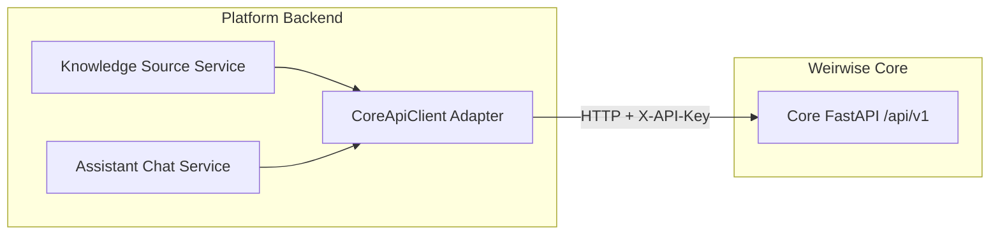

# Weirwise Platform API Contracts & Integration Boundaries

## 1. Verified Public Interface: Weirwise Core (v1.0.0)

Source verification performed directly against `C:\Users\Alireza\Desktop\weirwise\CONTRACT.md` and `C:\Users\Alireza\Desktop\weirwise\server\app\api.py`.

### A. Authentication
All tenant-scoped calls from Weirwise Platform to Weirwise Core MUST include:
```http
X-API-Key: ww_<32-byte-hex>
```

### B. Core Endpoints & Verified Signatures

| Endpoint | Method | Input Contract | Verified Output Contract |
| :--- | :--- | :--- | :--- |
| `/health/live` | `GET` | None | `{"status": "alive", "database": "unverified", "version": "1.0.0"}` |
| `/health/ready` | `GET` | None | `{"status": "ready"\|"degraded", "database": "healthy"\|"unreachable", "version": "1.0.0"}` |
| `/api/v1/knowledge-bases` | `POST` | `{"name": str, "description": str\|null}` | `KnowledgeBaseResponse` (`id`, `name`, `description`, `created_at`, `updated_at`) |
| `/api/v1/knowledge-bases` | `GET` | Query: `limit: int = 50, offset: int = 0` | `List[KnowledgeBaseResponse]` |
| `/api/v1/documents/upload` | `POST` | `multipart/form-data`: `file`, `knowledge_base_id: UUID` | HTTP 202: `DocumentUploadResponse` (`id`, `knowledge_base_id`, `filename`, `status: "pending"`, `created_at`) |
| `/api/v1/documents/{doc_id}` | `GET` | Path: `doc_id: UUID` | `DocumentResponse` (`id`, `status: "pending"\|"processing"\|"completed"\|"failed"`, `error_message`, `file_size`, etc.) |
| `/api/v1/search` | `POST` | `{"knowledge_base_id": UUID, "query": str, "top_k": int = 4, "score_threshold": float\|null}` | `{"results": [{"chunk_id": UUID, "document_id": UUID, "content": str, "similarity_score": float, "rank": int}], "total": int}` |
| `/api/v1/assistants` | `POST` | `{"name": str, "knowledge_base_id": UUID\|null, "system_instructions": str\|null, "model": str, "temperature": float, "max_tokens": int}` | `AssistantResponse` (`id`, `name`, `model`, etc.) |
| `/api/v1/assistants/{id}/chat` | `POST` | `{"message": str, "conversation_id": UUID\|null}` | `ChatResponse` (`conversation_id`, `message_id`, `role: "assistant"`, `content": str, `sources`: list) |

---

## 2. Integration Adapters & Mapping

Weirwise Platform interacts with Weirwise Core strictly through an explicit adapter interface (`CoreApiClient`).



### Entity Mapping Matrix

| Weirwise Platform Entity | Weirwise Core Entity | Mapping Strategy |
| :--- | :--- | :--- |
| `Workspace` | Core `Tenant` | 1:1 mapped or dedicated platform tenant API key provisioning. |
| `KnowledgeSource` | Core `KnowledgeBase` | When a `KnowledgeSource` is created in Platform, Platform issues `POST /api/v1/knowledge-bases` to Core and persists `core_kb_id`. |
| `Document` | Core `Document` | Uploading a document sends file bytes to Core `POST /api/v1/documents/upload` with `core_kb_id`, tracking Core's `doc_id`. |
| `Assistant` | Core `Assistant` / Search | Platform Assistant maps to Core Assistant (`POST /api/v1/assistants`). If an assistant attaches multiple sources, the adapter aggregates searches across Core knowledge bases. |

---

## 3. Discovered Discrepancies & Blockers

1. **Multi-Knowledge-Base Grounding in Core:**
   - **Discovered Invariant in Core:** Core `Assistant` schema currently accepts only one optional `knowledge_base_id` (`ForeignKey("knowledge_bases.id", ondelete="SET NULL")`).
   - **Platform Requirement:** Platform supports an Assistant attaching **multiple** Knowledge Sources (`AssistantKnowledgeSource` M:N).
   - **Solution in Platform Adapter:**
     - Until Core supports multi-KB assistants natively, Platform will use Core's `/api/v1/search` endpoint across each associated `knowledge_base_id`, re-rank/merge citations by similarity score, and feed the compiled context into the synthesis prompt, OR delegate to Core's single assistant when only 1 source is attached.
     - Documented as an adapter responsibility without modifying Core internals.

2. **Web Crawl / URL Connectors:**
   - Core v1.0.0 accepts file uploads (`multipart/form-data`) but has no built-in web scraper or headless crawler.
   - **Solution:** Platform worker handles crawling/scraping, cleans DOM into markdown/text files, and submits the resultant artifacts to Core's document ingestion API.
