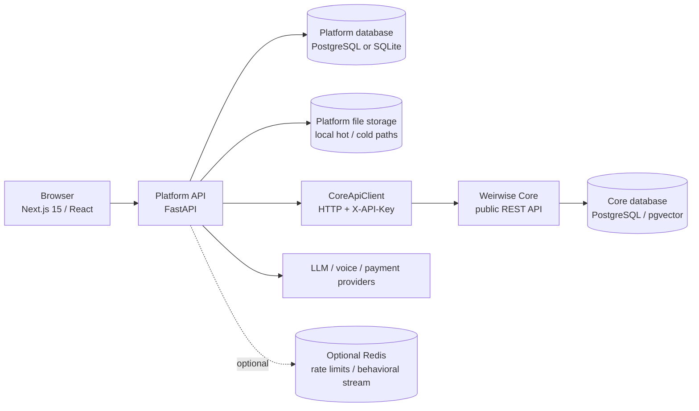

# Weirwise Platform Architecture

> **Status:** Current implementation overview, checked against source on November 10, 2026.
> This describes code in the repository, not a production deployment or a guarantee that every
> feature is enabled. Roadmap direction is in [`PRODUCT_VISION.md`](PRODUCT_VISION.md).

## 1. System boundary

Platform is a FastAPI and Next.js application with its own relational database and local file
storage. It calls Weirwise Core only through Core's public REST API, using the Platform adapter.
Core owns its API tenants, knowledge bases, documents, chunks, embeddings, and retrieval. Platform
does not import Core internals, share ORM models, or read the Core database.

## 2. Current module map

| Area | Location | Responsibility and boundary |
|---|---|---|
| Application lifecycle | `backend/app/main.py` | Registers API routers and middleware, initializes SQLAlchemy metadata, runs the database-reference-aware local-storage reaper plus Shopify and document-ingestion workers, and closes provider/Core clients. It does not own feature workflows. |
| HTTP API | `backend/app/api/v1/` | Authentication, knowledge, assistants, public runtime, billing, integrations, enterprise, admin, telemetry, health, and voice routes. Request/response schemas live in `backend/app/schemas/`. |
| Authentication and shared infrastructure | `backend/app/api/`, `backend/app/core/`, `backend/app/db/` | JWT/cookie resolution, settings, logging, security headers, SQLAlchemy engine/session, and declarative model base. |
| Domain persistence | `backend/app/models/` | User-owned accounts, knowledge sources/documents, assistants/conversations/deployments, credentials, usage, billing, and admin/routing records. The actual ownership model is summarized in [`DOMAIN_MODEL.md`](DOMAIN_MODEL.md). |
| Core boundary | `backend/app/adapters/core_client.py` | HTTP client for Core health, knowledge bases, document upload/status/deletion, search, and chat. It owns transport/error translation, not Core persistence or retrieval implementation. |
| Application services | `backend/app/services/` | Provider selection and calls, credential vault, metering, billing, storage, crawling, evaluation, webhooks, rate limiting, retention, and behavioral-event processing. |
| Document ingestion | `backend/app/tasks/ingestion.py` | Database-backed `ProcessingJob` worker stores Platform metadata/files, calls Core REST endpoints, polls Core indexing status, and updates Platform document/source state. Shopify catalog sync has a separate database-backed integration queue and application worker with stale-job recovery. |
| Browser application | `frontend/src/app/`, `frontend/src/components/`, `frontend/src/lib/` | Next.js App Router pages, UI components, API client, auth/theme/locale contexts, and telemetry. See [`FRONTEND_ARCHITECTURE.md`](FRONTEND_ARCHITECTURE.md). |

## 3. Ownership and service boundaries

- The customer-account boundary is the authenticated Platform `User`; there is no separate
  `Account` model. Customer-owned resources are scoped by that user. The schema has no persisted
  `workspaces`, `projects`, or `memberships` table and no database row-level security.
- Some auxiliary model/table names and legacy API/client symbols still say `workspace` or
  `project`; these are user-keyed compatibility artifacts, not customer-selectable spaces. See
  [`API_CONTRACTS.md`](API_CONTRACTS.md) and [`FRONTEND_ARCHITECTURE.md`](FRONTEND_ARCHITECTURE.md).
- Platform uses one configured Core API key through its service adapter; Core therefore sees the
  Platform service's Core tenant, not an individual Platform user identity. Platform must verify
  ownership of every user-owned source/assistant before using stored Core IDs. Core does not
  provide account management for Platform.
- Platform owns identity, assistant configuration, conversations, deployments, source/document
  metadata, billing/usage records, and provider-routing administration.
- Customer account isolation currently depends on authenticated-user resource ownership checks in
  Platform routes and services. A separate account membership or shared-account authorization
  layer is not implemented.
- Core owns its own API-key tenants, knowledge bases, uploaded indexing copies, chunks, vectors, and
  retrieval. Platform stores Core IDs as references and synchronizes through HTTP.
- The database and file stores remain separate. Core's document indexing is not a Platform database
  transaction; Platform ingestion polls Core and records the result locally.

## 4. Runtime and implementation status

- The assistant runtime retrieves passages from linked Core knowledge bases and generates or streams
  grounded responses through Platform's provider-routing service. When no usable passages exist, it
  uses the configured fallback; when provider generation cannot be used, the service can return an
  extractive answer from retrieved passages.
- Provider-pool routing and credential-vault code exists. Its presence does not establish a service
  plan, provider availability, or production configuration.
- Shopify OAuth and manual active-product catalog snapshots are implemented in Platform code; sync
  jobs persist as integration queue states and recover stale work. This is not a general external
  job broker and does not provide automatic retries for terminal failures, recurring updates,
  Shopify webhooks, or uninstall revocation. Generic sync for other providers still reports
  `not_implemented`.
- General document ingestion is persisted in `ProcessingJob` rows in the same transaction as
  document creation. The API lifespan runs a database-backed worker with atomic claims, heartbeats,
  and stale-job recovery up to the configured attempt limit. Terminal failures require a manual
  retry. This is an in-process worker backed by the Platform database, not an external broker.
  A separate Redis Streams behavioral-intelligence worker is present; Celery remains unwired.
- The app lifespan calls `Base.metadata.create_all`. Alembic files also exist. See
  [`DATA_AND_MIGRATIONS.md`](DATA_AND_MIGRATIONS.md) for this migration/startup distinction.
- `STORAGE_BACKEND` currently has a local implementation; no S3 adapter was found in the inspected
  application code. Actual storage paths are environment-configured.

Do not treat old phase plans, audit reports, or architecture sketches as evidence that a feature is
shipped. Use the source and tests for implementation claims, and separately verify release status
before calling anything released or production-enabled.

## 5. Related references

- [`API_CONTRACTS.md`](API_CONTRACTS.md) — current API surface and compatibility rules.
- [`DOMAIN_MODEL.md`](DOMAIN_MODEL.md) — persisted entities and ownership.
- [`DATA_AND_MIGRATIONS.md`](DATA_AND_MIGRATIONS.md) — database and schema evolution.
- [`AI_AND_INTEGRATIONS.md`](AI_AND_INTEGRATIONS.md) — Core, provider, and business-integration boundaries.
- [`FRONTEND_ARCHITECTURE.md`](FRONTEND_ARCHITECTURE.md) — UI composition and browser/API boundary.
- [`TESTING.md`](TESTING.md) — test levels and commands.
- [`SECURITY.md`](SECURITY.md) — verified controls and implementation caveats.
- [`adr/001-architecture-boundaries-and-core-decoupling.md`](adr/001-architecture-boundaries-and-core-decoupling.md) — accepted Core boundary.
