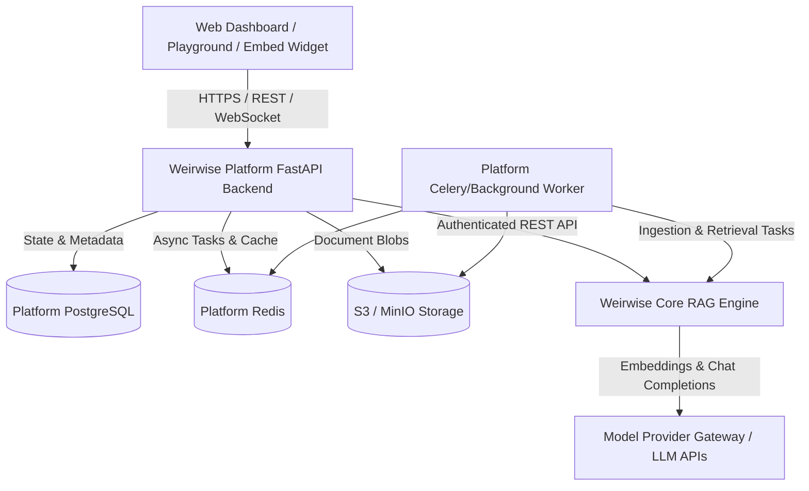

# Weirwise Platform Architecture Document

## 1. System Overview & Vision

**Weirwise Platform** is a multi-tenant enterprise AI assistant platform enabling businesses to create, configure, test, deploy, and manage AI assistants grounded in their own business data.

The system is architected as an independent SaaS application layer, strictly decoupled from underlying retrieval and model orchestration engines:
- **Weirwise Platform (This Service):** Owns SaaS customer boundaries, accounts, multi-tenant organizations (Workspaces), project contexts, assistant personalities, conversation workflows, deployment credentials, audit logging, and usage metering.
- **Weirwise Core (External Service):** A headless retrieval-augmented generation (RAG) engine that handles chunking, vector indexing, dense search, and raw LLM context synthesis.
- **Model Provider Gateway (External/Upstream):** Provider routing, fallback, and quota management.

---

## 2. Component Responsibilities & Boundaries

| Component | Responsibility | Boundary & Data Ownership |
| :--- | :--- | :--- |
| **Platform Frontend** | Next.js 14, Tailwind CSS, TypeScript management console, playground, analytics, and widget builder. | Communicates exclusively with Weirwise Platform Backend API via JWT / session tokens. |
| **Platform Backend** | FastAPI application hosting tenant authentication, workspace isolation, project scopes, assistant definitions, and deployment endpoints. | Owns Platform PostgreSQL database. Never directly queries Core database or Core internals. |
| **Platform Worker** | Celery / Redis asynchronous task execution for document pre-processing, sanitization, batch sync, and audit fanout. | Consumes background jobs from Platform Redis queue. |
| **Weirwise Core** | Document chunking, vector embedding, similarity retrieval, and RAG prompt assembly. | Separate service accessed strictly via `X-API-Key` HTTP REST API contract (v1.0.0). |

---

## 3. Data Flows

### A. Document Ingestion Flow
1. **User Action:** Organization admin uploads documents via Platform Dashboard (`POST /api/v1/projects/{project_id}/sources/{source_id}/documents`).
2. **Platform Validation:**
   - Platform backend verifies workspace and project membership.
   - Platform validates MIME type, magic bytes, and file size limits.
   - Platform securely persists raw document to Object Storage (S3 / MinIO) with a content hash.
3. **Async Dispatch:** Platform registers Document metadata in Platform DB (`status: pending`) and enqueues an ingestion job.
4. **Core Synchronization:** Worker feeds the document stream to Weirwise Core's verified API (`POST /api/v1/documents/upload` with tenant-scoped API key).
5. **Status Polling & Completion:** Worker tracks Core status (`GET /api/v1/documents/{doc_id}`) and marks platform document state as `ready` or `failed` with granular error diagnostics.

### B. Grounded Conversation & Playground Flow
1. **User Prompt:** Playground or deployed widget issues a chat prompt to Platform API (`POST /api/v1/assistants/{id}/chat`).
2. **Authorization & Rate Limiting:** Platform validates caller token/API key, checks project quotas, and logs `UsageEvent`.
3. **Core RAG Delegation:** Platform queries Weirwise Core (`POST /api/v1/assistants/{core_id}/chat` or combined retrieval `/api/v1/search`), injecting platform-level prompt overrides, safety guidelines, and active knowledge base scopes.
4. **Response & Citations:** Core returns content with structured chunk citations. Platform stores conversation history in Platform DB and streams output back to client.

---

## 4. Architectural Principles

1. **Strict Decoupling:** The Platform layer is a consumer of Core, not an extension of it. No shared databases, no direct internal library imports.
2. **Multi-Tenant Isolation First:** Every query and database transaction in the Platform is scoped to an authenticated `Workspace` and `Project`.
3. **Explicit State Machines:** Asynchronous operations (document sync, assistant deployment) transition through explicit, auditable states (`pending` -> `processing` -> `ready` / `failed`).
4. **Enterprise Observability:** All requests carry unique correlation IDs (`X-Correlation-ID`) across Platform, Worker, and Core API requests, with zero sensitive prompt or document leakage in logs.
