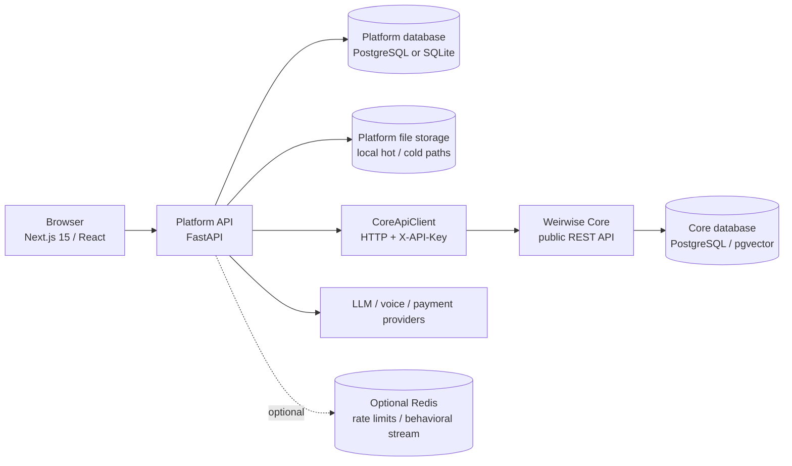

# Weirwise Platform Architecture

> **Status:** Current implementation overview, checked against source on November 10, 2026.
> This describes code in the repository, not a production deployment or a guarantee that every
> feature is enabled. Roadmap direction is in [`PRODUCT_VISION.md`](PRODUCT_VISION.md).

## 1. System boundary

Platform is a FastAPI and Next.js application with its own relational database and local file
storage. It calls Weirwise Core only through Core's public REST API, using the Platform adapter.
Core owns its API tenants, knowledge bases, documents, chunks, embeddings, and retrieval. Platform
does not import Core internals, share ORM models, or read the Core database.

## 2. Current module map

| Area | Location | Responsibility and boundary |
|---|---|---|
| Application lifecycle | `backend/app/main.py` | Registers API routers and middleware, initializes SQLAlchemy metadata, runs the local-storage reaper, and closes provider/Core clients. It does not own feature workflows. |
| HTTP API | `backend/app/api/v1/` | Authentication, knowledge, assistants, public runtime, billing, integrations, enterprise, admin, telemetry, health, and voice routes. Request/response schemas live in `backend/app/schemas/`. |
| Authentication and shared infrastructure | `backend/app/api/`, `backend/app/core/`, `backend/app/db/` | JWT/cookie resolution, settings, logging, security headers, SQLAlchemy engine/session, and declarative model base. |
| Domain persistence | `backend/app/models/` | User-owned accounts, knowledge sources/documents, assistants/conversations/deployments, credentials, usage, billing, and admin/routing records. The actual ownership model is summarized in [`DOMAIN_MODEL.md`](DOMAIN_MODEL.md). |
| Core boundary | `backend/app/adapters/core_client.py` | HTTP client for Core health, knowledge bases, document upload/status/deletion, search, and chat. It owns transport/error translation, not Core persistence or retrieval implementation. |
| Application services | `backend/app/services/` | Provider selection and calls, credential vault, metering, billing, storage, crawling, evaluation, webhooks, rate limiting, retention, and behavioral-event processing. |
| Document ingestion | `backend/app/tasks/ingestion.py` | FastAPI background-task workflow that stores Platform metadata/files, calls Core REST endpoints, polls Core indexing status, and updates Platform document/source state. |
| Browser application | `frontend/src/app/`, `frontend/src/components/`, `frontend/src/lib/` | Next.js App Router pages, UI components, API client, auth/theme/locale contexts, and telemetry. See [`FRONTEND_ARCHITECTURE.md`](FRONTEND_ARCHITECTURE.md). |

## 3. Ownership and service boundaries

- Platform records are primarily owned by `User` identifiers. There is no persisted `workspaces`
  principal table or `memberships` table. Some auxiliary tables retain `workspace_*` names; the
  entitlement model's `workspace_id` and the BYOK model's `project_id` are synonyms for `user_id`.
  These records do not establish a multi-user workspace.
  Some API/UI names and compatibility shims also use `workspace`/`project` terminology.
- Platform owns identity, assistant configuration, conversations, deployments, source/document
  metadata, billing/usage records, and provider-routing administration.
- Core owns its own API-key tenants, knowledge bases, uploaded indexing copies, chunks, vectors, and
  retrieval. Platform stores Core IDs as references and synchronizes through HTTP.
- The database and file stores remain separate. Core's document indexing is not a Platform database
  transaction; Platform ingestion polls Core and records the result locally.

## 4. Runtime and implementation status

- The assistant runtime retrieves passages from linked Core knowledge bases and generates or streams
  grounded responses through Platform's provider-routing service. When no usable passages exist, it
  uses the configured fallback; when provider generation cannot be used, the service can return an
  extractive answer from retrieved passages.
- Provider-pool routing and credential-vault code exists. Its presence does not establish a service
  plan, provider availability, or production configuration.
- Platform can save integration credentials, but the inspected generic integration sync path reports
  `not_implemented`; do not describe Shopify catalog import/sync as implemented.
- Document ingestion is dispatched with FastAPI `BackgroundTasks` in the request process. A separate
  Redis Streams behavioral-intelligence worker is present. Celery is a declared dependency, but no
  Celery application/task wiring for document ingestion was found.
- The app lifespan calls `Base.metadata.create_all`. Alembic files also exist. See
  [`DATA_AND_MIGRATIONS.md`](DATA_AND_MIGRATIONS.md) for this migration/startup distinction.
- `STORAGE_BACKEND` currently has a local implementation; no S3 adapter was found in the inspected
  application code. Actual storage paths are environment-configured.

Do not treat old phase plans, audit reports, or architecture sketches as evidence that a feature is
shipped. Use the source and tests for implementation claims, and separately verify release status
before calling anything released or production-enabled.

## 5. Related references

- [`API_CONTRACTS.md`](API_CONTRACTS.md) — current API surface and compatibility rules.
- [`DOMAIN_MODEL.md`](DOMAIN_MODEL.md) — persisted entities and ownership.
- [`DATA_AND_MIGRATIONS.md`](DATA_AND_MIGRATIONS.md) — database and schema evolution.
- [`AI_AND_INTEGRATIONS.md`](AI_AND_INTEGRATIONS.md) — Core, provider, and business-integration boundaries.
- [`FRONTEND_ARCHITECTURE.md`](FRONTEND_ARCHITECTURE.md) — UI composition and browser/API boundary.
- [`TESTING.md`](TESTING.md) — test levels and commands.
- [`SECURITY.md`](SECURITY.md) — verified controls and implementation caveats.
- [`adr/001-architecture-boundaries-and-core-decoupling.md`](adr/001-architecture-boundaries-and-core-decoupling.md) — accepted Core boundary.
