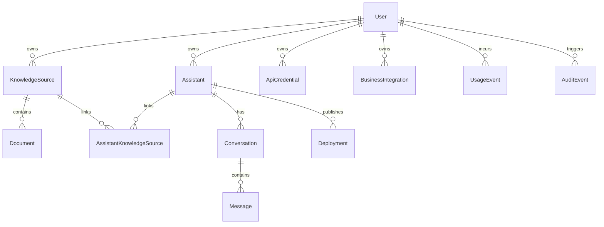

# Platform Persisted Domain Model

> This describes SQLAlchemy models in `backend/app/models/`, checked on November 10, 2026. It is
> not a product roadmap or a claim that every route is released.

## Ownership overview

## Persisted entities

| Entity | Owner and responsibility |
|---|---|
| `User` | Current customer-account principal and login identity, password hash, verification/admin flags, and authentication records. There is no separate `Account` entity or multi-user membership model. |
| `UserSession`, `PasswordResetToken`, `EmailVerificationToken` | User-scoped refresh-session and time-limited account-recovery/verification records; sensitive token values are hashed. |
| `KnowledgeSource` | Owned by `user_id`; represents an uploaded source or website crawl and may reference a Core knowledge base using `core_kb_id`. |
| `Document` | Belongs to a `KnowledgeSource`, which is owned by a user; its `user_id` is nullable in the current model. Ingestion sets it for normal upload flows. The parent source is the ownership path and must be checked before document operations. |
| `ProcessingJob` | Tracks Platform-side processing status and attempts for a document. |
| `Assistant` | Owned by `user_id`; contains behavior, grounding, language/tone, publication status, and a published configuration snapshot. `core_assistant_id` is an optional external reference, not a shared Core model. |
| `AssistantKnowledgeSource` | Many-to-many link between assistants and sources, with a priority value. Both sides must be checked against the owning user at the API boundary. |
| `Conversation`, `Message` | Conversation belongs to an assistant, which is user-owned; messages store role/content, citations, token usage, grounding state, and timing. Anonymous runtime conversations can use a session token. |
| `Deployment` | Belongs to an assistant and stores deployment type, a public widget key, allowed domains, and presentation configuration. |
| `ApiCredential` | User-owned Platform API key with a stored hash, scopes, active/revocation state, and optional expiry. |
| `BusinessIntegration` | User-owned provider connection with encrypted credentials and a `connection_key`; multiple connections to the same provider are supported for one user. |
| `UsageEvent`, `AuditEvent` | User-associated usage and audit records. Their presence does not imply a complete audit trail for every operation. |
| Billing/admin/provider models | Subscription/payment, provider account/credential, routing, and staff-control records. `WorkspacePlanEntitlement` and `WorkspaceBYOKCredential` are persisted auxiliary models keyed to `user_id`; their legacy names do not provide a workspace principal or membership relation. |

## Important boundaries and caveats

- The Platform's current customer-account principal is `User`. There is no separate `Account`
  model, persisted `workspaces`, `projects`, or `memberships` table, or multi-user account model.
  Legacy workspace/project API compatibility routes and auxiliary table names do not establish
  ownership or membership.
- Account isolation is enforced by Platform authentication and per-resource ownership checks; it is
  not implemented with PostgreSQL row-level security. Customer-facing routes must derive the
  account from the authenticated user rather than trust client-supplied tenant identifiers.
- Platform's `User` and Core's `Tenant` are separate identities. Core tenant isolation is enforced
  by Core API keys. The current Platform adapter uses a configured service key, so Core sees the
  Platform service tenant, not a per-user Core tenant. Platform's user-to-Core-ID ownership mapping
  and authorization checks are therefore a security-critical boundary.
- Core document IDs and knowledge-base IDs are opaque references. Platform must not query or
  reinterpret Core's database.
- `BusinessIntegration` is unique on `(user_id, provider, connection_key)` and its service upserts
  that triple. Older clients without a key use `default`; Shopify can derive the key from the shop
  domain. Multiple connection records are supported, but provider-specific OAuth, catalog
  synchronization, retries, and analysis are not implemented by this persistence change.
- Legacy `/workspaces` and `/projects` API routes are compatibility shims. They are not the
  customer account model and are deprecated for new clients; see [`API_CONTRACTS.md`](API_CONTRACTS.md).
