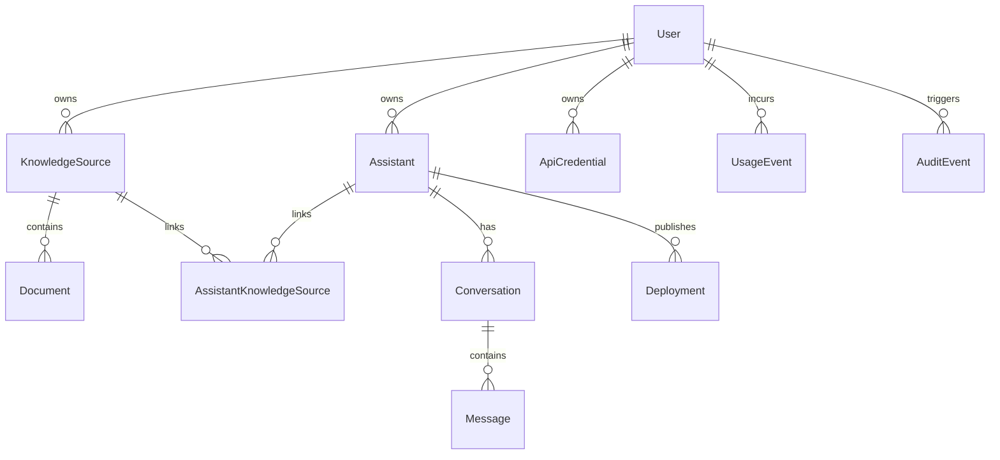

# Platform Persisted Domain Model

> This describes SQLAlchemy models in `backend/app/models/`, checked on November 10, 2026. It is
> not a product roadmap or a claim that every route is released.

## Ownership overview

## Persisted entities

| Entity | Owner and responsibility |
|---|---|
| `User` | Account identity, password hash, verification/admin flags, and authentication records. |
| `UserSession`, `PasswordResetToken`, `EmailVerificationToken` | User-scoped refresh-session and time-limited account-recovery/verification records; sensitive token values are hashed. |
| `KnowledgeSource` | Owned by `user_id`; represents an uploaded source or website crawl and may reference a Core knowledge base using `core_kb_id`. |
| `Document` | Belongs to a user and `KnowledgeSource`; stores Platform metadata and a local storage path, and may reference the indexed Core document using `core_doc_id`. |
| `ProcessingJob` | Tracks Platform-side processing status and attempts for a document. |
| `Assistant` | Owned by `user_id`; contains behavior, grounding, language/tone, publication status, and a published configuration snapshot. `core_assistant_id` is an optional external reference, not a shared Core model. |
| `AssistantKnowledgeSource` | Many-to-many link between assistants and sources, with a priority value. Both sides must be checked against the owning user at the API boundary. |
| `Conversation`, `Message` | Conversation belongs to an assistant; messages store role/content, citations, token usage, grounding state, and timing. Anonymous runtime conversations can use a session token. |
| `Deployment` | Belongs to an assistant and stores deployment type, a public widget key, allowed domains, and presentation configuration. |
| `ApiCredential` | User-owned Platform API key with a stored hash, scopes, active/revocation state, and optional expiry. |
| `UsageEvent`, `AuditEvent` | User-associated usage and audit records. Their presence does not imply a complete audit trail for every operation. |
| Billing/admin/provider models | Subscription/payment, provider account/credential, routing, and staff-control records. `WorkspacePlanEntitlement` and `WorkspaceBYOKCredential` are persisted auxiliary models keyed to `user_id`; the former exposes `workspace_id` and the latter `project_id` as synonyms for `user_id`. Neither provides a workspace principal or Membership relation. |

## Important boundaries and caveats

- The inspected Platform schema is **user-scoped**, not workspace/membership-scoped. There is no
  persisted `workspaces` principal table or `memberships` table. The model modules also contain
  legacy `Workspace`/`Project` compatibility shims and `project_id`/`workspace_id` synonyms; the
  synonyms resolve to `user_id` and do not provide persisted multi-user workspace authorization.
- Frontend storage keys and compatibility API names containing `workspace` or `project` do not
  change the database ownership model.
- Platform's `User` and Core's `Tenant` are separate identities. Core tenant isolation is enforced
  by Core API keys; Platform owns the mapping and communicates with Core over REST.
- Core document IDs and knowledge-base IDs are opaque references. Platform must not query or
  reinterpret Core's database.
- Do not add a persisted workspace, membership, role, or cross-user sharing assumption to docs or
  routes until such a schema and authorization model are implemented and tested.
