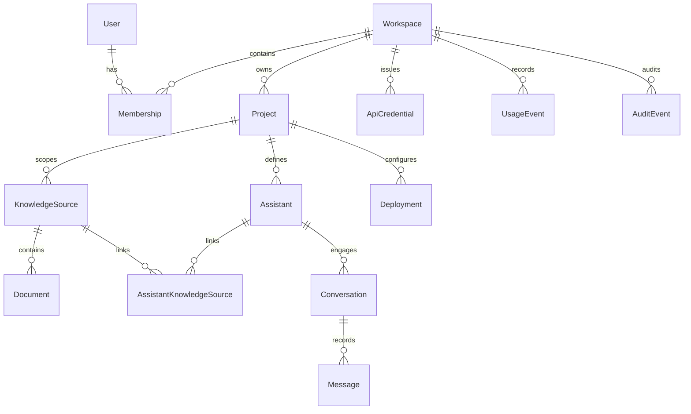

# Weirwise Platform Domain Model

## 1. Conceptual Domain Hierarchy

The domain model enforces strong tenancy, separation of concerns, and least-privilege scoping across all resources.

---

## 2. Core Entities & Invariants

### 1. User & Identity
- **Entity:** `User`
- **Fields:** `id` (UUID), `email` (string, unique), `hashed_password` (string), `full_name` (string), `is_active` (bool), `is_superuser` (bool), `created_at`, `updated_at`.
- **Invariants:** Every user account exists globally, but data access is strictly bounded by `Membership` records in specific Workspaces.

### 2. Workspace
- **Entity:** `Workspace`
- **Fields:** `id` (UUID), `name` (string), `slug` (string, unique), `plan_tier` (string: free, pro, enterprise), `settings` (JSON), `created_at`, `updated_at`.
- **Invariants:** The top-level administrative and billing boundary. Cross-workspace access is prohibited.

### 3. Membership & Roles
- **Entity:** `Membership`
- **Fields:** `id` (UUID), `user_id` (FK), `workspace_id` (FK), `role` (enum: `owner`, `admin`, `member`, `viewer`), `created_at`.
- **Invariants:** Unique constraint on `(user_id, workspace_id)`. Role dictates platform actions (e.g., only `owner`/`admin` can invite users or manage API credentials).

### 4. Project
- **Entity:** `Project`
- **Fields:** `id` (UUID), `workspace_id` (FK), `name` (string), `slug` (string), `description` (text), `created_at`, `updated_at`.
- **Invariants:**
  - Belongs to exactly one Workspace.
  - Assistants and KnowledgeSources are partitioned within a Project.

### 5. KnowledgeSource
- **Entity:** `KnowledgeSource`
- **Fields:** `id` (UUID), `project_id` (FK), `core_kb_id` (UUID, nullable), `name` (string), `type` (enum: `file_upload`, `web_crawl`, `notion`, `confluence`), `status` (enum: `draft`, `syncing`, `active`, `error`), `sync_schedule` (string), `created_at`, `updated_at`.
- **Invariants:**
  - Scoped to a single Project.
  - Maps to a tenant knowledge base in Weirwise Core via `core_kb_id`.

### 6. Document
- **Entity:** `Document`
- **Fields:** `id` (UUID), `knowledge_source_id` (FK), `core_doc_id` (UUID, nullable), `filename` (string), `mime_type` (string), `file_size_bytes` (bigint), `content_hash` (string, SHA-256), `storage_uri` (string), `status` (enum: `pending`, `uploaded`, `indexing`, `ready`, `failed`), `error_reason` (text), `created_at`, `updated_at`.
- **Invariants:** Represents an atomic file or crawled page. Status transitions are monotonically tracked.

### 7. Assistant
- **Entity:** `Assistant`
- **Fields:** `id` (UUID), `project_id` (FK), `core_assistant_id` (UUID, nullable), `name` (string), `description` (text), `system_instructions` (text), `model_name` (string), `temperature` (float), `max_tokens` (int), `retrieval_threshold` (float), `top_k` (int), `is_published` (bool), `created_at`, `updated_at`.
- **Invariants:**
  - Scoped to one Project.
  - Configures conversational behavior and grounding parameters.

### 8. AssistantKnowledgeSource
- **Entity:** `AssistantKnowledgeSource`
- **Fields:** `assistant_id` (FK), `knowledge_source_id` (FK), `priority` (int), `created_at`.
- **Invariants:**
  - Compound primary key `(assistant_id, knowledge_source_id)`.
  - Both Assistant and KnowledgeSource must belong to the exact same Project.

### 9. Conversation & Message
- **Entity:** `Conversation`
  - Fields: `id` (UUID), `assistant_id` (FK), `user_id` (FK, nullable), `session_token` (string, nullable), `title` (string), `created_at`, `updated_at`.
- **Entity:** `Message`
  - Fields: `id` (UUID), `conversation_id` (FK), `role` (enum: `user`, `assistant`, `system`), `content` (text), `citations` (JSON), `token_count` (int), `latency_ms` (int), `created_at`.

### 10. Deployment
- **Entity:** `Deployment`
- **Fields:** `id` (UUID), `assistant_id` (FK), `type` (enum: `web_widget`, `public_api`, `slack_bot`), `allowed_domains` (list of strings), `theme_config` (JSON), `is_active` (bool), `created_at`, `updated_at`.

### 11. ApiCredential
- **Entity:** `ApiCredential`
- **Fields:** `id` (UUID), `workspace_id` (FK), `name` (string), `key_prefix` (string, e.g. `wwp_live_`), `key_hash` (string, SHA-256), `scopes` (list of strings), `expires_at` (datetime, nullable), `revoked_at` (datetime, nullable), `created_at`.
- **Invariants:** Plaintext secret shown only once upon creation. Hash verification enforced on every incoming request.

### 12. UsageEvent & AuditEvent
- **Entity:** `UsageEvent`
  - Fields: `id` (UUID), `workspace_id` (FK), `project_id` (FK), `assistant_id` (FK), `event_type` (e.g. `chat_turn`, `document_chunk_indexed`), `units` (int), `timestamp`.
- **Entity:** `AuditEvent`
  - Fields: `id` (UUID), `workspace_id` (FK), `user_id` (FK, nullable), `action` (string), `resource_type` (string), `resource_id` (UUID), `metadata` (JSON), `ip_address` (string), `timestamp`.
