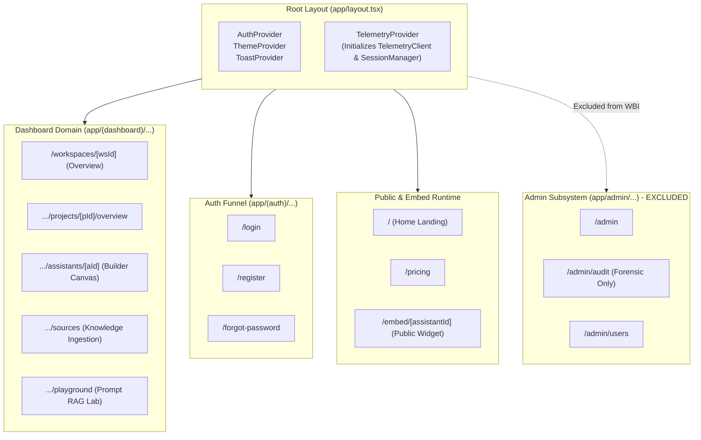
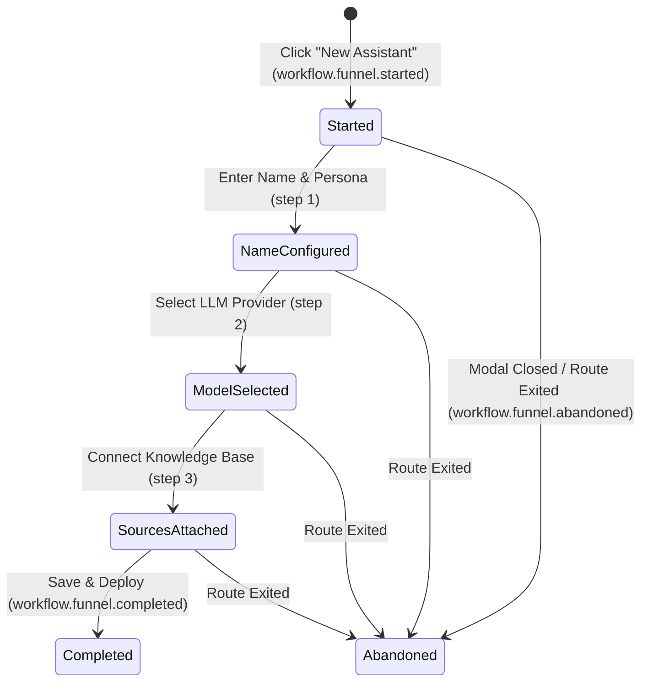

# Weirwise Behavioral Intelligence (WBI) – Frontend Integration Map

**Document Status:** Implementation Blueprint  
**Target Codebase:** `frontend/src/`  
**Date:** November 3, 2026  

---

## 1. Actual Application Route Inventory & Instrumentation Boundaries

An exhaustive scan of the Next.js App Router tree in `frontend/src/app` identifies 24 primary routes across four distinct architectural domains.



---

## 2. Route-by-Route Instrumentation Specification

| Route Pattern | File Path | Scope Status | Key Workflows & Events | Sensitive Data Boundary |
| :--- | :--- | :--- | :--- | :--- |
| **Workspace Hub**<br>`/workspaces/[workspaceId]` | `src/app/(dashboard)/workspaces/[workspaceId]/page.tsx` | **Tracked** | • `navigation.route.viewed`<br>• `action.button.clicked` (`btn_create_project`) | Exclude project descriptions containing internal proprietary notes. |
| **Project Overview**<br>`.../projects/[projectId]/overview` | `src/app/(dashboard)/workspaces/[workspaceId]/projects/[projectId]/overview/page.tsx` | **Tracked** | • `navigation.route.viewed`<br>• `feature.project_summary.viewed` | Standard metadata only. |
| **Assistant Builder**<br>`.../assistants/[assistantId]` | `src/app/(dashboard)/workspaces/[workspaceId]/projects/[projectId]/assistants/[assistantId]/page.tsx` | **Tracked** | • Workflow `wf_configure_assistant`<br>• `feature.assistant_builder.saved`<br>• `friction.form.validation_failed` | **Strict Boundary**: System prompt instructions and private API keys are NEVER captured in telemetry properties. |
| **Knowledge Sources**<br>`.../sources` | `src/app/(dashboard)/workspaces/[workspaceId]/projects/[projectId]/sources/page.tsx` | **Tracked** | • Workflow `wf_upload_documents`<br>• Workflow `wf_crawl_website`<br>• `action.tab.switched`<br>• `friction.operation.aborted` | **Strict Boundary**: Document contents, parsed text chunks, and proprietary URLs with auth tokens are NEVER captured. Only filename extensions, byte sizes, and status codes. |
| **RAG Playground**<br>`.../playground` | `src/app/(dashboard)/workspaces/[workspaceId]/projects/[projectId]/playground/page.tsx` | **Tracked** | • `feature.rag_playground.prompt_tested`<br>• `action.button.clicked` (`btn_clear_history`)<br>• `navigation.dwell.heartbeat` | **Strict Boundary**: User queries and assistant responses in the chat canvas are NEVER captured in behavioral telemetry. Track query latency, citation count, and token metrics only. |
| **Embed Widget**<br>`/embed/[assistantId]` | `src/app/embed/[assistantId]/page.tsx` | **Tracked** (`access_environment: "embedded_widget"`) | • `workflow.widget_conversation.started`<br>• `action.button.clicked` (`btn_send_message`)<br>• `friction.action.retried` | **Strict Boundary**: Zero customer chat text. Zero visitor credentials. |
| **Auth Funnel**<br>`/login`, `/register` | `src/app/(auth)/login/page.tsx`, `register/page.tsx` | **Tracked** (Funnel Only) | • `workflow.auth_funnel.started`<br>• `workflow.auth_funnel.completed`<br>• `friction.form.validation_failed` | **Strict Boundary**: Zero password, email, or token capture. Track form submission success or failure reason code only (`AUTH_FAILED`, `EMAIL_EXISTS`). |
| **Admin Control Center**<br>`/admin/*` | `src/app/admin/*` | **EXCLUDED** | Admin operations emit exclusively to `AdminAuditLog` (`/admin/audit`). WBI is disabled on all `/admin` routes. | N/A |
| **Marketing & Static**<br>`/`, `/pricing`, `/blog/*` | `src/app/page.tsx`, `pricing/page.tsx`, `blog/*` | **Lightweight** | • `navigation.route.viewed`<br>• `action.button.clicked` (`btn_cta_signup`) | Anonymous page views and top-level CTA clicks only. |

---

## 3. High-Value Funnels & Workflow State Machines

### 3.1 Assistant Creation & Configuration Funnel (`wf_configure_assistant`)


### 3.2 Document Upload & Processing Funnel (`wf_upload_documents`)
- **Stage 1 (`file_selected`)**: Files dropped or selected via file browser (`properties: { file_count: 3, extensions: ["pdf", "docx"] }`).
- **Stage 2 (`upload_dispatched`)**: Multi-part upload initialized.
- **Stage 3 (`indexing_progress`)**: Background embedding and chunking observed.
- **Outcome A (`completed`)**: All documents status `indexed` (`duration_ms` recorded).
- **Outcome B (`failed`)**: File validation or backend processing failure (`error_code` recorded).

---

## 4. Proposed Developer Integration Hooks

To prevent boilerplate pollution and guarantee centralized sanitization, developers will use three simple React hooks:

### 4.1 Primary Hook: `useTelemetry()`
```typescript
import { useTelemetry } from "@/lib/telemetry";

export function AssistantSaveButton({ assistantId }: { assistantId: string }) {
  const { trackAction, trackFeature } = useTelemetry();

  const handleSave = async () => {
    trackAction("btn_save_assistant", { assistant_id: assistantId });
    trackFeature("assistant_builder", "save_canvas");
    await api.updateAssistant(assistantId, data);
  };

  return <button onClick={handleSave}>Save</button>;
}
```

### 4.2 Route Watcher: Automatic Page Views (`useRouteTelemetry()`)
Mounted once in `TelemetryProvider` at the root layout:
```typescript
// Watches pathname and searchParams changes via Next.js navigation hooks
const pathname = usePathname();
useEffect(() => {
  if (isExcludedRoute(pathname)) return;
  telemetryClient.trackPageView(pathname);
}, [pathname]);
```

### 4.3 Multi-Step Funnel Hook: `useWorkflow()`
Manages workflow state, step timing, and abandonment detection:
```typescript
import { useWorkflow } from "@/lib/telemetry";

export function AssistantWizardModal({ isOpen, onClose }: Props) {
  const workflow = useWorkflow("wf_create_assistant");

  useEffect(() => {
    if (isOpen) {
      workflow.start({ template: "customer_support" });
    } else if (workflow.isActive) {
      workflow.abandon("modal_dismissed");
    }
  }, [isOpen]);

  const handleComplete = async () => {
    await submitAssistant();
    workflow.complete();
  };
}
```

---

## 5. Centralized UI Instrumentation Strategy

To avoid manually wrapping hundreds of individual buttons while preventing fragile global DOM click scrapers:

1. **Declarative Component Attribute**:
   The shared UI button component (`frontend/src/components/ui/button.tsx`) accepts an optional prop:
   ```typescript
   interface ButtonProps {
     telemetryId?: string;       // e.g. "btn_create_project"
     telemetryCategory?: string; // e.g. "action" (default)
     telemetryProps?: Record<string, any>;
   }
   ```
2. **Explicit Action Dispatch**:
   When `telemetryId` is provided, `Button` fires `trackAction(telemetryId, telemetryProps)` on click. If `telemetryId` is omitted, the button functions normally without emitting uncoordinated telemetry.
