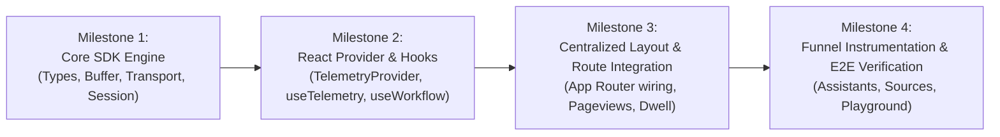

# Weirwise Behavioral Intelligence (WBI) – Phase 2 Implementation Plan

**Document Status:** Implementation Plan (Pending Authorization)  
**Target Milestone:** WBI Phase 2 (Frontend Telemetry SDK & Component Instrumentation)  
**Target Branch:** `develop`  
**Date:** November 3, 2026  

---

## 1. Implementation Overview

Phase 2 will be executed across four distinct, test-driven milestones. Each milestone delivers an independently verified module with zero regression risk to existing platform features.

---

## 2. Milestone Breakdown

### Milestone 1: Core Telemetry SDK Engine
- **Objective**: Implement the headless TypeScript telemetry client with buffer, session manager, sanitizer, and network transport.
- **Files to Create**:
  - `frontend/src/lib/telemetry/types.ts`
  - `frontend/src/lib/telemetry/sanitizer.ts`
  - `frontend/src/lib/telemetry/session.ts`
  - `frontend/src/lib/telemetry/context.ts`
  - `frontend/src/lib/telemetry/buffer.ts`
  - `frontend/src/lib/telemetry/transport.ts`
  - `frontend/src/lib/telemetry/client.ts`
- **Unit & Headless Tests**:
  - Verify UUID event ID generation and ISO 8601 UTC timestamps.
  - Verify sensitive keyword filtering (`password`, `token`, `secret`, `api_key`).
  - Verify session sliding inactivity expiration (30 minutes).
  - Verify in-memory buffer capacity (max 200) and drop-oldest overflow policy.
  - Verify batch grouping (25 events) and retry backoff on network failures.
- **Acceptance Criteria**: Headless test suite passes 100%; bundle size overhead $\le 6.5\text{ KB}$.

---

### Milestone 2: React Context & Custom Hooks
- **Objective**: Create the React provider and ergonomic developer hooks for functional components.
- **Files to Create**:
  - `frontend/src/lib/telemetry/provider.tsx`
  - `frontend/src/lib/telemetry/workflows.ts`
  - `frontend/src/lib/telemetry/index.ts`
- **Integration Points**:
  - React Context wrapping `TelemetryClient` instance.
  - `useTelemetry()` hook for one-line tracking (`trackAction`, `trackFeature`).
  - `useWorkflow(workflowId)` hook for stateful multi-step funnel tracking.
- **Tests**:
  - Verify React components render without SSR hydration warnings.
  - Verify mock tracking calls inside rendered test components.
- **Acceptance Criteria**: Seamless developer ergonomics; zero React re-render penalties.

---

### Milestone 3: Global Layout & Navigation Route Watcher
- **Objective**: Wire `TelemetryProvider` into the application root layout and automatically track route changes and dwell times.
- **Files to Modify**:
  - `frontend/src/app/layout.tsx`: Add `<TelemetryProvider>` inside `<AuthProvider>`.
  - `frontend/src/components/ui/button.tsx`: Add optional `telemetryId` prop.
- **Key Capabilities**:
  - Automatically captures `navigation.route.viewed` on client-side route transitions.
  - Emits `navigation.dwell.heartbeat` every 30 seconds of active user focus.
  - Explicitly bypasses `/admin/*` routes to preserve segregation with Admin Audit Trail.
  - Emits buffer flushes on browser `pagehide` and `visibilitychange`.
- **Tests**:
  - Verify route change emits single `navigation.route.viewed`.
  - Verify tab blur/minimize immediately stops dwell heartbeats.
- **Acceptance Criteria**: Automatic navigation tracking operates with zero page performance lag.

---

### Milestone 4: High-Value Workflow Instrumentation & End-to-End Verification
- **Objective**: Instrument primary product workflows and execute full end-to-end integration tests against the live dev backend (`weirwise-dev-backend`).
- **Files to Instrument**:
  - `frontend/src/app/(dashboard)/workspaces/[workspaceId]/projects/[projectId]/assistants/page.tsx`: New assistant funnel.
  - `frontend/src/app/(dashboard)/workspaces/[workspaceId]/projects/[projectId]/sources/page.tsx`: Document upload and crawler funnel.
  - `frontend/src/app/(dashboard)/workspaces/[workspaceId]/projects/[projectId]/playground/page.tsx`: Prompt playground query testing.
  - `frontend/src/app/embed/[assistantId]/page.tsx`: Embed widget conversation start.
- **End-to-End Verification**:
  - Trigger user actions in the frontend and assert batch ingestion via HTTP 202.
  - Verify events flow into Redis Stream `wbi:events:incoming`.
  - Verify worker consumes events and persists to PostgreSQL `behavioral_events`.
  - Verify zero duplicate rows, zero schema validation errors, and zero dropped events.
- **Acceptance Criteria**: Complete end-to-end lifecycle verified from browser click to PostgreSQL row.

---

## 3. Risk Assessment & Mitigations

| Identified Technical Risk | Risk Level | Mitigation Strategy |
| :--- | :--- | :--- |
| **Next.js SSR Hydration Mismatch** | Medium | All browser DOM, screen, and storage APIs are strictly guarded behind `useEffect` and `typeof window !== "undefined"`. |
| **High Network Request Volume** | Medium | Events are strictly buffered in memory and batched (25 events or 10-second timer). Dwell heartbeats require active window focus and pause during inactivity. |
| **Sensitive Payload Leakage** | High | Multi-layered defense: client-side `EventSanitizer` allowlist check + server-side Pydantic regex validator + server-side keyword rejection. |
| **Admin Audit Trail Pollution** | High | Telemetry SDK explicitly skips all `/admin/*` routes. Admin actions continue routing exclusively to `AdminAuditLog`. |
| **Backend 429 Ingestion Backpressure** | Low | Transport pauses flushes for 60 seconds upon receiving HTTP 429. User experience is never interrupted. |
