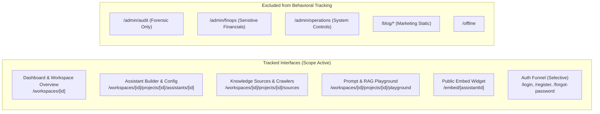
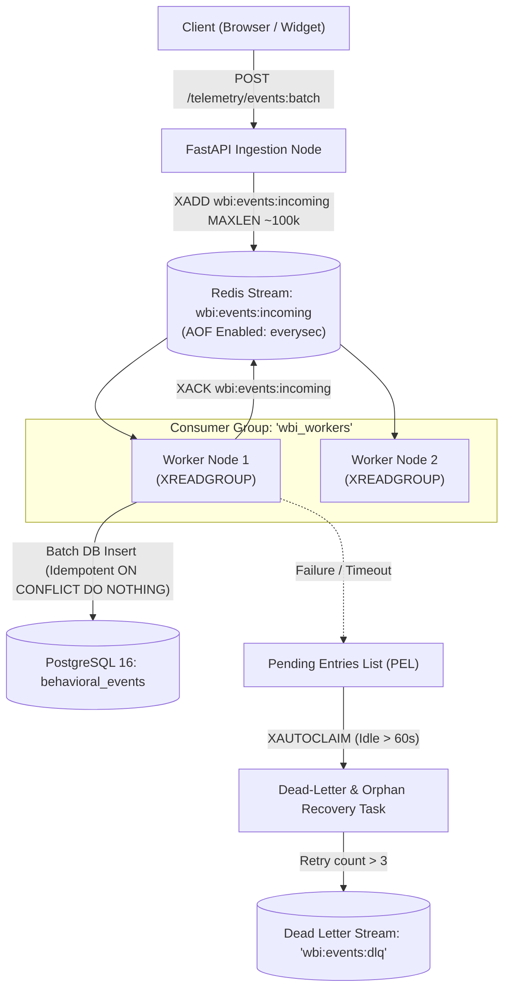

# Weirwise Behavioral Intelligence Subsystem: Revised Technical Architecture & Design Specification (v2.0)

**Document Status:** Revised Architecture Proposal (Pending Final Approval)  
**Author:** Antigravity Engineering  
**Target Branch:** `develop`  
**System Name:** Weirwise Behavioral Intelligence (`WBI`)  
**Date:** November 3, 2026  

---

## 1. Executive Summary & Purpose

The **Weirwise Behavioral Intelligence (`WBI`)** subsystem is a purpose-built behavioral observation, analytics aggregation, and LLM-powered insight generation system. Its mission is to make Weirwise progressively understand how real users and operators interact with the platform—identifying discovered and dormant features, workflow abandonment, friction points, retry loops, and long-term behavioral trends.

### Strict Architectural Boundaries: WBI vs. Admin Audit Trail
As mandated by architectural policy, **Weirwise Behavioral Intelligence must remain strictly separated from the Admin Audit Trail (`AdminAuditLog` / `admin_audit_logs`)**:

| Dimension | Admin Audit Trail (`AdminAuditLog`) | Behavioral Intelligence (`WBI`) |
| :--- | :--- | :--- |
| **Domain Purpose** | Forensic accountability, compliance, non-repudiation, administrative security. | Product understanding, feature discovery, workflow UX optimization. |
| **Event Category** | Security mutations (credential creation/revocation, role grants, billing tier updates). | Interaction telemetry (page dwell, navigation paths, button clicks, retry loops, friction). |
| **Target Audience** | Platform staff, compliance auditors, security officers. | Product teams, platform operators, workspace administrators, AI insight agents. |
| **Retention Policy** | Fixed compliance window (e.g. 1–7 years, strict append-only, zero redaction). | Multi-tiered lifecycle: raw events pruned after 45 days; session aggregates and profiles kept longer. |
| **Access Control** | Super Admin & Platform Staff only (`require_admin_role`). | Workspace-scoped for tenant admins; system-wide for platform administrators. |
| **Synthesis Layer** | None (factual cryptographic ledger). | Asynchronous batch LLM reasoning & pattern discovery. |

---

## 2. Product Coverage: Interface Tracking Catalog

Behavioral tracking is **not** globally applied to all routes. Only designated high-value business, management, and runtime interfaces will emit telemetry.



### Detailed Coverage Matrix

| Route Pattern | Interface Purpose | Tracked Event Categories | Justification & Exclusion Rules |
| :--- | :--- | :--- | :--- |
| `/workspaces/[id]` | Workspace overview & navigation hub | `navigation`, `feature_used` | Measure workspace activation and feature discovery. |
| `.../assistants/[assistantId]` | Assistant builder & configuration | `feature_used`, `workflow`, `friction` | Critical creation funnel; detect configuration abandonment and parameter errors. |
| `.../sources` | Knowledge ingestion & crawler setup | `workflow`, `action`, `error` | Track document uploads, URL crawling status, and ingestion retry friction. |
| `.../playground` | Prompt experimentation & RAG testing | `feature_used`, `dwell_heartbeat` | High-value retention driver; measure query iterations and citation click-throughs. |
| `/embed/[assistantId]` | Public runtime iframe & chat widget | `navigation`, `workflow`, `friction` | Measure end-customer conversation start, abandonment, and thumbs feedback. |
| `/login`, `/register` | Authentication funnel | `workflow_started`, `workflow_completed` | High-level funnel drop-off only. **Strictly no keystroke, password, or field value tracking.** |
| `/admin/*` | Administrative control center | **EXCLUDED** | Admin actions are tracked exclusively in `admin_audit_logs`. No behavioral tracking. |
| `/blog/*`, `/pricing` | Public marketing pages | `page_view` (aggregated only) | Standard anonymous page views without deep telemetry. |

---

## 3. Event Taxonomy & Data Model

### 3.1 Standardized Naming Convention
All events follow the dot-notation standard: `<domain>.<object>.<action>` (e.g. `assistant.builder.saved`, `knowledge.crawl.started`, `ui.button.clicked`).

### 3.2 Categorized Event Taxonomy

1. **Navigation & Presence (`navigation`)**:
   - `navigation.route.viewed`: Transition to a tracked route, recording previous route and referrer.
   - `navigation.dwell.heartbeat`: Emitted every 30 seconds of active browser tab focus (pauses when tab is blurred or hidden).
2. **Feature Engagement (`feature`)**:
   - `feature.discovery.viewed`: Target feature or sub-component enters viewport (`IntersectionObserver`).
   - `feature.action.triggered`: Deliberate usage of a tool (e.g. "crawl_website", "run_golden_eval").
3. **Workflow Funnel (`workflow`)**:
   - `workflow.funnel.started`: E.g. Assistant creation wizard initiated.
   - `workflow.step.reached`: Progression to step $N$ (e.g. Step 2: Grounding Sources).
   - `workflow.funnel.completed`: Terminal success state reached.
   - `workflow.funnel.abandoned`: Exited workflow without completion (records time spent and last step).
4. **Friction & Anomalies (`friction`)**:
   - `friction.click.rage`: $\ge 3$ clicks within 800ms on the same element identifier.
   - `friction.action.retry_loop`: Submitting a failed action $\ge 2$ times consecutively.
   - `friction.form.validation_failed`: Client-side validation blocks progress (records field identifier only, never field content).
5. **Errors & Degradation (`error`)**:
   - `error.client.exception`: Unhandled React component crash or boundary catch.
   - `error.api.failure`: Backend 4xx/5xx response received (records endpoint route, HTTP status code, and error category slug; payload contents strictly omitted).

### 3.3 Event Payload Schema

```typescript
export interface BehavioralEventPayload {
  eventId: string;             // Client-generated UUIDv4 (idempotency key)
  sessionId: string;           // UUIDv4 identifying browser session
  userId?: string | null;      // Authenticated user UUID (null for pre-auth)
  workspaceId?: string | null; // Active workspace UUID context
  
  category: "navigation" | "feature" | "workflow" | "friction" | "error";
  eventName: string;           // Standardized format: domain.object.action
  componentId?: string;        // Semantic identifier: e.g. "btn-test-prompt", "tab-sources"
  
  route: string;               // Normalized route: e.g. "/workspaces/[id]/assistants/[id]"
  referrerRoute?: string;      // Previous route
  
  timestamp: string;           // ISO 8601 UTC timestamp client-side
  durationMs?: number;         // Milliseconds for dwell or workflow step
  
  properties: Record<string, any>; // Strictly sanitized metadata (counters, step names)
  
  clientContext: {
    deviceCategory: "desktop" | "mobile" | "tablet";
    viewport: { width: number; height: number };
    locale: string;
  };
}
```

---

## 4. Redis Streams Reliability Architecture

Redis Streams (`wbi:events:incoming`) serves as the high-throughput ingestion buffer. To ensure enterprise-grade reliability and prevent data loss, the following operational controls are specified:



### 4.1 Persistence & AOF Configuration
- Redis in production runs with **Append-Only File (`AOF`)** enabled with `appendfsync everysec`.
- In the event of a container restart, maximum potential write loss is bounded to $<1$ second.

### 4.2 Consumer Groups & Acknowledgment Protocol
- Stream Name: `wbi:events:incoming`
- Consumer Group: `wbi_workers`
- Flow:
  1. Workers fetch batches using `XREADGROUP GROUP wbi_workers worker_N COUNT 100 BLOCK 2000 STREAMS wbi:events:incoming >`.
  2. The batch is processed and written to PostgreSQL in a single database transaction.
  3. Upon successful transaction commit, worker sends `XACK wbi:events:incoming wbi_workers <msg_id_1> <msg_id_2>...`.

### 4.3 Idempotent Processing
- Every event carries a client-generated UUIDv4 `eventId`.
- PostgreSQL schema enforces a unique constraint on `(id)`.
- Ingestion inserts use `INSERT ... ON CONFLICT (id) DO NOTHING`.
- If a worker crashes before sending `XACK` and another worker re-processes the message, the duplicate insert safely evaluates as a no-op without duplicating metrics.

### 4.4 Worker Failure Recovery & Dead-Letter Handling
- **Pending Entries List (`PEL`)**: Unacknowledged messages remain in the PEL.
- **Orphan Auto-Claim**: A periodic background task invokes `XAUTOCLAIM wbi:events:incoming wbi_workers recovery_worker 60000 0-0 COUNT 50` to reassign messages idle for $>60$ seconds.
- **Retry Ceiling & Dead-Letter Queue**: If a message fails ingestion $\ge 3$ times (checked via delivery counter in PEL), it is routed to `XADD wbi:events:dlq * ...` and acknowledged from the primary stream to prevent poison-pill worker blocking.

### 4.5 Memory Limits & Backpressure
- Streams are capped using approximate trimming: `XADD wbi:events:incoming MAXLEN ~ 100000 * payload ...`.
- At 100,000 maximum pending records, Redis memory footprint for the stream remains bounded to approximately 40–60 MB.
- Ingestion API verifies stream length before accepting batches; if stream backlog exceeds 80,000 items, ingestion returns `HTTP 429 Too Many Requests` (Backpressure Signal) prompting clients to back off.

---

## 5. Storage Architecture & Partitioning Evaluation

### 5.1 Partitioning Evaluation
An objective architectural evaluation was conducted to assess whether PostgreSQL monthly table partitioning is justified:

- **Current Repository Scale**: Platform database holds 623 users, 251 audit events, and 354 usage events.
- **Projected Behavioral Ingestion**: With ~5,000 daily active sessions averaging 50 events each, daily event volume is estimated at ~250,000 records (~7.5 million records/month).
- **Architectural Conclusion**:
  - *PostgreSQL native partitioning adds operational complexity* (manual partition creation or pg_partman extension management, index constraints across partitions, migration friction).
  - Standard PostgreSQL 16 handles 10–25 million rows in a single indexed table comfortably without performance degradation, provided proper B-Tree indexing on `(user_id, created_at)` and `(created_at)` is maintained.
  - **Decision**: Start with a **single unpartitioned table** (`behavioral_events`) with targeted composite indexes. Defer physical monthly partitioning until empirical benchmarks demonstrate table scan degradation ($>30\text{M}$ active rows).

### 5.2 Multi-Tiered Data Models

```sql
-- 1. Raw Behavioral Events (45-Day Retention Target)
CREATE TABLE behavioral_events (
    id UUID PRIMARY KEY,
    session_id UUID NOT NULL,
    user_id UUID REFERENCES users(id) ON DELETE CASCADE,
    workspace_id UUID REFERENCES workspaces(id) ON DELETE CASCADE,
    category VARCHAR(32) NOT NULL,
    event_name VARCHAR(64) NOT NULL,
    component_id VARCHAR(128),
    route VARCHAR(255) NOT NULL,
    duration_ms INTEGER,
    properties JSONB DEFAULT '{}'::jsonb NOT NULL,
    device_category VARCHAR(16) NOT NULL,
    created_at TIMESTAMPTZ DEFAULT clock_timestamp() NOT NULL
);

CREATE INDEX ix_bev_user_created ON behavioral_events (user_id, created_at DESC);
CREATE INDEX ix_bev_session_created ON behavioral_events (session_id, created_at ASC);
CREATE INDEX ix_bev_created_at ON behavioral_events (created_at);
CREATE INDEX ix_bev_category_name ON behavioral_events (category, event_name);

-- 2. Behavioral Sessions (Aggregated session metadata, 180-Day Retention Target)
CREATE TABLE user_behavioral_sessions (
    id UUID PRIMARY KEY DEFAULT gen_random_uuid(),
    session_id UUID UNIQUE NOT NULL,
    user_id UUID REFERENCES users(id) ON DELETE CASCADE,
    workspace_id UUID REFERENCES workspaces(id) ON DELETE CASCADE,
    first_seen_at TIMESTAMPTZ NOT NULL,
    last_seen_at TIMESTAMPTZ NOT NULL,
    total_duration_seconds INTEGER DEFAULT 0 NOT NULL,
    page_view_count INTEGER DEFAULT 0 NOT NULL,
    event_count INTEGER DEFAULT 0 NOT NULL,
    entry_route VARCHAR(255) NOT NULL,
    exit_route VARCHAR(255),
    completed_workflows JSONB DEFAULT '[]'::jsonb NOT NULL,
    abandoned_workflows JSONB DEFAULT '[]'::jsonb NOT NULL,
    friction_count INTEGER DEFAULT 0 NOT NULL,
    is_bounce BOOLEAN DEFAULT FALSE NOT NULL,
    created_at TIMESTAMPTZ DEFAULT clock_timestamp() NOT NULL
);

CREATE INDEX ix_ubs_user_time ON user_behavioral_sessions (user_id, first_seen_at DESC);
CREATE INDEX ix_ubs_created_at ON user_behavioral_sessions (created_at);

-- 3. Materialized User Behavioral Profile (Account Lifetime / Pruned on User Deletion)
CREATE TABLE user_behavioral_profiles (
    user_id UUID PRIMARY KEY REFERENCES users(id) ON DELETE CASCADE,
    workspace_id UUID REFERENCES workspaces(id) ON DELETE CASCADE,
    
    total_active_days INTEGER DEFAULT 0 NOT NULL,
    total_sessions INTEGER DEFAULT 0 NOT NULL,
    total_dwell_time_minutes INTEGER DEFAULT 0 NOT NULL,
    
    -- Feature affinity maps: { "prompt_playground": 42, "vector_search": 12 }
    feature_usage_frequency JSONB DEFAULT '{}'::jsonb NOT NULL,
    dormant_features JSONB DEFAULT '[]'::jsonb NOT NULL,
    
    -- Friction aggregates: { "rage_clicks_total": 4, "frequent_error_routes": ["/assistants/config"] }
    friction_indicators JSONB DEFAULT '{}'::jsonb NOT NULL,
    
    -- Journey habits: { "common_entry": "/workspaces/projects", "top_workflows": ["assistant_deploy"] }
    journey_patterns JSONB DEFAULT '{}'::jsonb NOT NULL,
    
    last_active_at TIMESTAMPTZ,
    last_profile_sync_at TIMESTAMPTZ DEFAULT clock_timestamp() NOT NULL,
    updated_at TIMESTAMPTZ DEFAULT clock_timestamp() NOT NULL
);

-- 4. AI Behavioral Insights (1-Year Retention Target)
CREATE TABLE behavioral_insights (
    id UUID PRIMARY KEY DEFAULT gen_random_uuid(),
    target_type VARCHAR(32) NOT NULL, -- 'user' | 'workspace' | 'global_platform'
    target_id UUID,                   -- user_id or workspace_id (nullable for global)
    time_window_start TIMESTAMPTZ NOT NULL,
    time_window_end TIMESTAMPTZ NOT NULL,
    
    summary TEXT NOT NULL,
    observed_facts JSONB DEFAULT '[]'::jsonb NOT NULL,      -- Concrete data points
    statistical_patterns JSONB DEFAULT '[]'::jsonb NOT NULL, -- Aggregate verified trends
    hypotheses JSONB DEFAULT '[]'::jsonb NOT NULL,          -- Testable explanations
    recommendations JSONB DEFAULT '[]'::jsonb NOT NULL,     -- Actionable UX suggestions
    
    confidence_level VARCHAR(16) NOT NULL,                  -- 'high' | 'medium' | 'exploratory'
    supporting_evidence JSONB DEFAULT '{}'::jsonb NOT NULL, -- Referenced session IDs & metrics
    limitations TEXT,                                       -- Blind spots / caveats
    
    model_name VARCHAR(64) NOT NULL,
    prompt_tokens INTEGER DEFAULT 0 NOT NULL,
    completion_tokens INTEGER DEFAULT 0 NOT NULL,
    created_at TIMESTAMPTZ DEFAULT clock_timestamp() NOT NULL
);

CREATE INDEX ix_bi_target_lookup ON behavioral_insights (target_type, target_id, created_at DESC);
CREATE INDEX ix_bi_created_at ON behavioral_insights (created_at);
```

---

## 6. Granular Retention & Pruning Strategy

To comply with data minimization and avoid indefinite accumulation of personal data:

| Tier | Entity | Proposed Retention Target | Pruning Mechanism |
| :--- | :--- | :--- | :--- |
| **Tier 1: Raw Events** | `behavioral_events` | **45 days** (Adjustable baseline) | Automated nightly query: `DELETE FROM behavioral_events WHERE created_at < NOW() - INTERVAL '45 days'` in chunked batches. |
| **Tier 2: Session Aggregates** | `user_behavioral_sessions` | **180 days** | Automated monthly sweep: `DELETE FROM user_behavioral_sessions WHERE created_at < NOW() - INTERVAL '180 days'`. |
| **Tier 3: Profile Aggregates** | `user_behavioral_profiles` | **Account Lifetime** | Retained while user exists. Instantly hard-deleted via `ON DELETE CASCADE` upon user deletion. |
| **Tier 4: AI Insights** | `behavioral_insights` | **365 days (1 year)** | Older historical reports pruned after 1 year to reflect current product versions. |

---

## 7. User Behavioral Profiles & Epistemic AI Insights

### 7.1 Entity Relationships
```
[User] 1 <---> 1 [user_behavioral_profiles] (High-level aggregated metrics)
[User] 1 <---> * [user_behavioral_sessions] (Session journey rolls)
[User] 1 <---> * [behavioral_events]        (Raw interaction records, 45d TTL)
[User] 1 <---> * [behavioral_insights]      (AI synthesis with evidence links)
```

### 7.2 Strict Epistemic Discipline for AI Insights
The system prompts executing via `IntelligentRoutingEngine` enforce strict epistemological boundaries:

```json
{
  "summary": "User Alpha frequently configures RAG retrieval thresholds but routinely abandons the live publishing workflow.",
  "observed_facts": [
    "User adjusted 'retrieval_threshold' 14 times in 3 days across 5 sessions.",
    "User initiated 'assistant_publish_wizard' 3 times but exited at Step 2 without generating an embed snippet.",
    "Client recorded 2 API 400 Bad Request responses on endpoint /api/v1/assistants/validate."
  ],
  "statistical_patterns": [
    "Dwell time in Assistant Playground averages 4.2 minutes per session (vs platform median 1.5 minutes).",
    "Publishing abandonment rate is 100% (3 out of 3 attempts)."
  ],
  "hypotheses": [
    "Hypothesis: The assistant pre-flight validation check failed due to missing grounding documents, but error feedback was not clearly displayed in the UI."
  ],
  "recommendations": [
    "Improve inline pre-flight error messaging on the Assistant Publish modal to clearly highlight unindexed sources."
  ],
  "confidence_level": "high",
  "supporting_evidence": {
    "session_ids": ["f47ac10b-58cc-4372-a567-0e02b2c3d479", "7c9e6679-7425-40de-944b-e07fc1f90ae7"],
    "total_observation_hours": 72
  },
  "limitations": "Observation window spans only 3 days; user has not tested voice modalities."
}
```

**Banned Inferences**:
- No psychological or emotional claims (e.g. *never* "user felt frustrated", "user was confused", or "user lost interest").
- No assertions of unobserved intent. Every hypothesis must be explicitly titled "Hypothesis" and grounded in supporting session evidence.

---

## 8. Privacy, Security & Legal Governance

### 8.1 Legitimate Interest vs. Consent-Dependent Tracking
1. **Core First-Party Interaction Telemetry (Active by Default)**:
   - Covers feature usage counters, workflow step completion, route dwell times, and error telemetry.
   - Evaluated under GDPR Art. 6(1)(f) Legitimate Interest: ensuring software reliability, discovering broken UI interactions, and fixing platform errors.
2. **Potentially Consent-Dependent Tracking (DISABLED by Default)**:
   - Cross-domain tracking, third-party attribution tags, session replay engines (e.g. DOM video-like recording), and cross-session anonymous tracking without authentication.
   - **Mandate**: These capabilities remain strictly **disabled** in the architecture. WBI collects only first-party semantic events.

### 8.2 Client-Side Redaction & Anti-Surveillance Controls
- **Zero Raw Mouse Trajectories**: No streaming of $(x, y)$ coordinate paths. Rage clicks are computed locally in JavaScript and transmitted only as a single discrete event counter.
- **Strict Element Masking**: Attributes only capture `data-track-id`. If missing, only the tag and component name are recorded. Inner text of headings, paragraphs, and buttons is never transmitted unless matching a curated enum of static UI button labels.
- **Form Data Filtering**: Input elements (`<input>`, `<textarea>`, `<select>`) are intercepted by a global filter that strips all values. Telemetry only records whether the field was focused or blurred, never what was typed.

---

## 9. Performance & Testing Targets (Empirically Testable)

To replace unverified performance claims with concrete engineering targets, the following benchmark criteria are established:

| Metric | Target | Measurement Methodology |
| :--- | :--- | :--- |
| **Ingestion API Latency ($P_{95}$)** | $\le 15\text{ ms}$ | Benchmarked with `wrk` or `locust` simulating 500 concurrent client flushes against `POST /api/v1/telemetry/events:batch`. |
| **Ingestion Throughput** | $\ge 2,500\text{ events/sec}$ | Tested against single backend container running 4 Uvicorn workers connected to Redis 7. |
| **Queue Processing Latency** | $\le 2\text{ seconds}$ | Time elapsed from `XADD` to PostgreSQL `COMMIT` under normal operating load. |
| **Frontend Overhead ($P_{99}$)** | $\le 1.5\text{ ms}$ main thread time | Measured via Chrome DevTools Performance Profiler during event capture and buffer insertion. |
| **Client Bundle Size** | $\le 7\text{ KB}$ (gzipped) | Verified via `@next/bundle-analyzer` in frontend production build. |
| **Zero Event Loss on Restart** | $100\%$ delivery of acknowledged events | Verified by terminating worker during active stream processing; unacknowledged events recovered via `XAUTOCLAIM`. |

---

## 10. Summary of Architectural Decisions Changed in this Revision

1. **Redis Streams Ingestion**: Retained as preferred mechanism, now fortified with detailed AOF persistence policies, PEL auto-claim, 3-retry dead-letter queue (`wbi:events:dlq`), and memory backpressure signaling at 80k backlog. Latency re-framed as a testable benchmark target ($\le 15\text{ ms}$).
2. **Storage Architecture**: Removed immediate PostgreSQL monthly partitioning complexity in favor of an optimized, indexed single table (`behavioral_events`), deferring partitioning until data volume empirical evidence ($>30\text{M}$ rows) warrants it.
3. **Retention Policy**: 45 days established as a configurable baseline for raw events; session aggregates kept for 180 days, profiles for account lifetime, and AI insights for 1 year.
4. **Product Coverage Cataloged**: Explicitly audited and scoped 6 key product interfaces (Workspace Overview, Assistant Builder, Knowledge Sources, Playground, Widget, Auth funnels) while strictly excluding admin panels, static blog, and sensitive finance routes.
5. **Epistemic Discipline**: Mandated structured JSON schema for AI insights with explicit bans on emotional and psychological inferences.

---

## 11. Proposed Phase 1 Implementation Scope (Upon Approval)

Upon your explicit approval of this revised specification, **Phase 1** will encompass only the core ingestion foundations without altering existing product behavior:

1. **Database Models & Alembic Migration**:
   - Create tables: `behavioral_events`, `user_behavioral_sessions`, `user_behavioral_profiles`, `behavioral_insights`.
   - Setup foreign keys and indexes.
2. **Ingestion API Endpoint**:
   - Implement `POST /api/v1/telemetry/events:batch` in FastAPI.
   - Pydantic v2 validation schema with strict field limits.
   - O(1) batch append to Redis Stream `wbi:events:incoming`.
3. **Stream Consumer Worker Scaffolding**:
   - Async background consumer task reading from Redis Stream group `wbi_workers`.
   - Batch insert into PostgreSQL with idempotent `ON CONFLICT DO NOTHING`.
   - Automatic PEL recovery and dead-letter routing.
4. **Ingestion Benchmark Test Suite**:
   - Automated test suite validating throughput, retry recovery, and zero data loss on simulated worker crash.
